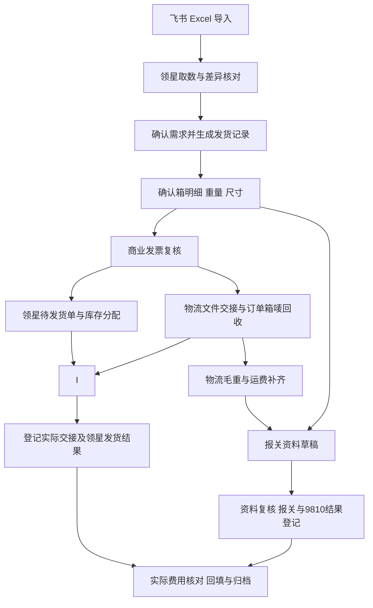
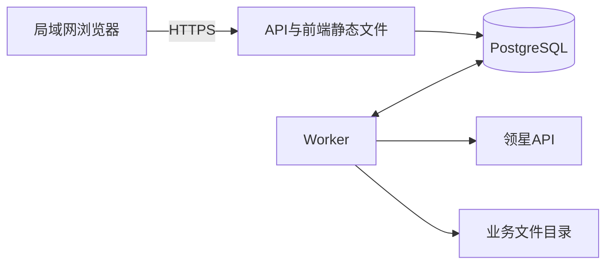

# 发货全流程自动化系统实施方案

> 历史阶段计划：保留编写当时的设计、安排和判断，不作为现行功能或操作说明。当前范围见[实现状态](../../development/implementation-status.md)、[业务规则](../../business/rules.md)与[运行维护](../../operations/runbook.md)；同目录背景见[历史索引](../README.md)。新发票不再以 M3 实物箱整组确认为前置条件，外部业务操作继续由人员执行。

> 更新日期：2026-10-11。本文件作为系统开发、模块交付和业务验收的统一依据。系统采用 TypeScript 技术栈和 Neo 任务工作台界面，按模块逐步交付；每个模块完成后即可使用，并继续复用同一批业务数据。

## 一、建设目标与业务范围

建立一套连接发货需求、领星、物流、报关资料和费用对账的内部系统。运营导入需求后，系统持续复用货件、商品和箱数据，自动完成数据整理、文件生成和结果关联，让每票货件都能追溯到原始需求、有效单据、外部结果及费用。

### 运行条件

| 项目 | 实施条件 |
| --- | --- |
| 使用规模 | 单仓，每周约 1000 箱以内，同时操作不超过 5 人 |
| 部署位置 | 一台专用、常开的 Windows 电脑，其他电脑通过局域网浏览器访问 |
| 开发维护 | 由业务负责人配合 AI 分模块开发、试用和维护 |
| 需求入口 | 人工从飞书导出 Excel，导入系统 |
| 领星接入 | 查询和写入优先使用已经验证的官方 API |
| 物流对接 | 生成示例物流商物流所需文件，人工上传，回收订单、箱唛、重量及费用 |
| 报关对接 | 生成资料并复核，由单证人员在现用平台提交，登记报关及 9810 结果 |
| 数据基础 | 已有 FBA 货件、领星数据、确认后的箱明细、重量尺寸和业务档案 |

### 系统交付内容

1. 发货批次和需求导入，支持每周建批次、每日追加与变更核对。
2. 领星货件、商品、装箱和本地仓库存查询，自动整理发货记录。
3. 箱数据补录、数量与重量尺寸校验及确认。
4. 商业发票、物流导入文件及报关资料的模板生成、复核与版本管理。
5. 领星待发货单创建、辅料与组合商品核对、库存分配及确认发货。
6. 物流订单、线下出货复核、实际交接结果和异常记录。
7. 报关单、复审、9810 订单及申报结果登记。
8. 实际费用核对、分摊、回填回查和批次归档。

库存分配异常由人员在现有领星流程中处理，系统记录原因、对应单据和核对结果，重新查询后继续。本系统接收线下已确认的箱数据、出货复核结果及交接凭据。

## 二、业务流程与完成条件



单据、领星、物流、报关和费用分别维护状态。报关资料可提前准备；取得物流数据后补齐并复核。流程中的箭头表示数据依赖，各渠道的出货和申报时点由确认后的规则控制。

一个批次可以包含多个货件、多张商业发票、多张领星发货单、多个物流订单和报关资料组。系统按成员范围显示“待处理、处理中、部分完成、暂停、结果未知、完成、取消处理中、已取消”等状态。

### 四项人工确认

| 确认动作 | 确认内容 | 系统记录 |
| --- | --- | --- |
| 需求确认 | 本次发货范围、数量、店铺、国家、渠道和地址 | 确认人、时间、范围及数据版本 |
| 箱数据与单据复核 | 箱内商品数量、箱数、重量尺寸、单据字段与分组 | 检查结果、数据和文件版本、必要附件 |
| 出货放行与交接登记 | 库存分配、有效单据、线下出货复核及实际交出的箱子 | 放行记录、承运方、箱子范围、时间及交接凭据 |
| 申报与费用确认 | 主体、商品申报、外部结果、金额币种及分摊 | 复核人、外部编号、结果凭据与费用版本 |

系统发货与实物交接分别保存。默认登记交接事实后执行领星确认发货；需要不同顺序的渠道应先确认规则。接口不支持部分出货时，由人员完成外部操作并登记实际结果。

### 批次完成条件

当前有效成员范围同时满足以下条件，批次才可归档完成：

- 需求、箱数据和相关单据已确认，文件及来源可追溯。
- 出货复核通过，实际物流交接已登记，领星发货结果已回查。
- 所需报关及 9810 结果有确认凭据；不适用步骤有明确规则或原因。
- 实际费用已核对、回填并回查；确认无需费用的项目保留依据。
- 结果未知、未解决差异和更正待办已经处理。

## 三、技术架构与界面

### 选定技术栈

技术版本基线沿用 2026-10-08 的选型记录；项目初始化时验证兼容性并锁定确切补丁版本。以下为开发方案，真实账号和性能按模块验收。

| 部分 | 采用方案 | 用途 |
| --- | --- | --- |
| 语言与项目 | TypeScript strict、pnpm workspaces | 前端、后台与任务使用同一语言 |
| 前端 | React 19.3、Vite 8.3 | 局域网交互式管理界面，静态构建部署 |
| UI | shadcn/ui、Tailwind CSS 4、Lucide | Neo 样式、表单、弹窗、状态和图标 |
| 查询与表格 | TanStack Query 5、Table 9；Virtual 3 按需启用 | 查询刷新、筛选排序、分页和长表显示 |
| 路由与表单 | TanStack Router 1、React Hook Form | 批次直达、详情标签页及字段级错误 |
| 后台 | Hono 4、Node.js 24 LTS、Zod | `/api/v1` 接口、参数校验与业务执行 |
| 数据库 | PostgreSQL 18、Drizzle ORM 0.45、pg | 业务关系、版本、事务、审计及数据库迁移 |
| 持久任务 | pg-boss 12.37、独立 Worker | 领星同步、解析、制单、文件处理和回查 |
| 登录 | Better Auth 本地账号和服务端会话 | 运营、单证、财务、管理员的后台权限检查 |
| Excel | ExcelJS | `.xlsx` 导入及业务模板输出 |
| DOCX | docxtemplater、PizZip | Word 单据模板填充和归档 |
| 金额与重量 | PostgreSQL NUMERIC、decimal.js | 接口传十进制字符串，避免浮点误差 |
| 文件 | 独立本机数据目录、数据库索引及 SHA-256 | 模板、生成版本、账单、物流附件和凭据留档 |
| 验证 | 类型检查、导入边界 lint、Vitest、Playwright | 业务规则、权限、恢复及浏览器操作验收 |

### 运行结构

API 提供业务接口和前端静态文件；Worker 执行耗时任务；PostgreSQL 作为本机服务运行。



后台按业务模块组织，API 与 Worker 共用业务规则和数据库访问。路由处理认证、权限与输入校验；模块执行业务规则和事务。共享校验与字段类型进入 `packages/contracts`，浏览器端仅使用适合前端的内容。

拟建目录如下，随模块交付逐步建立：

```text
apps/
  web/src/
    components/ui/       共用控件
    components/app-shell.tsx
    pages/               工作台、批次、单据、费用
    index.css            Neo主题变量
  server/src/
    api.ts
    worker.ts
    modules/
      imports/           需求导入
      shipments/         批次、货件、箱数据与放行
      lingxing/          查询、写入与结果核对
      documents/         模板、文件与复核
      logistics/         物流资料、订单及交接
      customs/           报关、9810与结果
      finance/           费用、分摊与对账
    db/
  server/drizzle/        数据库迁移
packages/contracts/      共享字段及校验
docs/                    规则、字段、验收与运维说明
```

### Neo 任务工作台规范

| 一级入口 | 页面职责 |
| --- | --- |
| 工作台 | 显示待办数量、负责人、阻塞原因和下一步；主操作为导入 Excel |
| 发货批次 | 批次筛选与详情；详情包含概览、箱数据、单据、领星与物流、报关、费用 |
| 单据中心 | 文件版本、复核、预览和下载 |
| 费用对账 | 原账单、分摊、拟回填金额和核对记录 |

| 视觉与交互 | 规范 |
| --- | --- |
| 基础颜色 | 画布 `#F5F5F0`，卡片／侧栏 `#FFFFFF`，正文与选中导航 `#0A0A0A` |
| 主操作 | 青柠 `#C8FF00`、悬停 `#D4FD8E`，黑字胶囊按钮 |
| 辅助颜色 | 次级文字 `#60645C`，分隔线 `#DDDFD5`，输入框边线 `#858D7E` |
| 状态 | 成功 `#176741`／`#E9F6EE`，待确认 `#855500`／`#FFF5D8`，失败 `#B32936`／`#FFF0F1`；配文字和图标 |
| 焦点与行悬停 | 焦点 `#304FFE`、2px 轮廓并外移 3px；悬停 `#EDF5D8` |
| 字体 | 中文优先 Microsoft YaHei／PingFang SC／system-ui；编号使用等宽字体，数字列右对齐 |
| 排版 | 正文 14px，辅助文字 12px，卡片标题 16px，页标题约 27px；手机输入至少 16px |
| 尺寸 | 卡片圆角 16px、内边距 20–24px；主按钮／输入至少 44px 高；触屏点击区域至少 44px |
| 布局 | 侧栏展开约 208px、收起约 76px；桌面内容边距 24–32px，窄屏 16px；白卡表格使用轻表头与水平分隔 |
| 动效 | 普通过渡 180–200ms，尊重减少动态效果设置 |

页面需要完整显示加载、空数据、失败、无权限、待确认和结果未知状态。入口随模块交付逐步开放；业务档案、规则和模板的维护入口放在所属模块中。待办直接打开对应批次与标签页，首页数量和服务状态来自真实查询／心跳。外部写入前展示店铺、单据或货件、数量／金额和数据版本；执行中阻止重复提交。

在 1024px 桌面和 320px、390px 窄屏验收导航、表格及预览。页面整体不横向溢出，宽表只在自身容器内滚动；键盘焦点、标签页和侧栏收起均可操作。

## 四、数据与业务规则

### 核心对象

| 对象 | 必须保存的内容与关系 |
| --- | --- |
| 导入记录 | 原文件哈希、工作表和源行、映射版本、原始值、规范化值及导入结果 |
| 批次与货件 | 稳定 ID、月份／周次、负责人；货件按店铺 ID＋FBA 号唯一，批次归属独立记录 |
| 商品与箱内明细 | SKU、MSKU、FNSKU、ASIN、本地商品 ID、数量单位；支持一箱多个 SKU |
| 箱子 | 本地箱 ID、平台箱号、内部编码、箱内商品、重量尺寸、来源及确认版本 |
| 单据组与成员 | 发票、领星、物流、报关分别分组，保存成员货件／箱子和数量快照 |
| 外部关联 | 领星单号、物流订单、跟踪号、报关单号、9810 订单号及其对应范围 |
| 文件与规则 | 模板／规则／数据版本、文件哈希、复核记录和被替代关系 |
| 操作与异常 | 操作 ID、请求摘要、逐项结果、核对时间、原因、负责人及恢复条件 |
| 费用与分摊 | 原账单、费用行、币种、收费范围、分摊行、确认及回填结果 |

一箱使用稳定内部 ID，货件内箱号唯一，同一实物箱只能关联一个有效出货范围。批次名称、编码和文件名用于展示。跨批次拆货或部分出货必须指定成员箱子／数量，并核对外部系统支持的操作方式。

### 字段映射

每个字段明确来源、类型、单位、必填时点、修改权限和冲突处理。来源冲突进入差异预览；同步数据先保存快照，再由人员确认是否采用。

| 字段组 | 最低内容 |
| --- | --- |
| 店铺及主体 | 店铺 ID、经营／境内发货单位、生产销售单位、企业代码、地址和联系方式 |
| 收件资料 | 国家、公司／人、平台仓库代码、邮编、省市、完整地址、电话和邮箱 |
| 国家渠道 | 示例渠道A／示例渠道B／示例渠道C、示例物流商 物流商 ID、领星渠道 ID、物流服务、运输方式、税务类型和 VAT |
| 商业发票 | 箱数、收发件资料、Reference ID／PO Number、中英文品名、数量单位、单价总价和币种、材质、HS、用途、品牌型号及商品链接 |
| 报关资料 | 合同号、主体、包装种类、件数、毛净重、成交方式、运保杂费及各自币种、国别／口岸／运输、提运单号、申报要素及法定单位 |
| 9810 | 订单号、平台及企业、SKU／FNSKU、成交数量单位、单价总价、商品币种、运费及运费币种 |
| 包装与辅料 | 商品单位换算、组合关系、纸箱／辅料 ID、辅料数量及费用关联方式 |

需求数量以运营确认版本为准；实际箱数据以线下确认版本为准；申报主体、商品、税务和金额使用负责人确认的档案。计划量、确认装箱量、拟发货量和领星实际发货量分别保存。实测毛重、物流毛重、体积与计费重并存，按用途分别取值。

### 导入、数量与编码

- 周一建立当周批次，每日可以追加。按稳定业务标识处理跨周／跨月重复数据。
- 一个 FBA 的多条 SKU 行是合法明细；货件去重与商品行识别分别处理。
- 相同数据重复导入保持原记录；数量、渠道、地址变化显示差异，确认后更新。
- 缺失源行保持原状态；减少数量或撤销需求需要明确选择并确认。
- 导入先预览校验，再提交；部分提交需人员明确选择成功范围。飞书“已拿”清单只包含实际成功项，并保存回源表标记结果。
- 编号按文本读取，保留前导零；按表头和字段语义清洗，缺失货件、分页不完整、单位不明或数量不一致均显示受影响范围。
- 箱数按箱 ID 去重；箱内数量合计与货件商品量对应；“套／片／件／箱”使用已确认的商品换算配置。
- 箱明细支持超过 10 箱，旧表输出按已验收方式扩列或拆页。
- 欧洲按 FBA 分类编码；美国分组采用人员确认的“五箱一样”匹配条件。编码在批次内唯一，追加货件保持已确认或已交物流编码稳定。

### 分组与模板

| 对象 | 分组规则 |
| --- | --- |
| 商业发票 | 店铺、目的国家、渠道、收件主体／仓库、完整地址；币种和税务类型不同继续拆分 |
| 领星发货单 | 在商业发票条件上增加实际出库仓及接口约束 |
| 物流订单 | 按物流模板和接单规则组织，可人工拆单并保留成员关系 |
| 报关资料 | 按已确认主体、国家渠道和申报条件组织；跨国家合并由单证逐组确认 |

多个 Reference ID 保存逐货件映射，按正式模板表达。跨国合并保留全部成员国家、地址和税务字段，关联总数量及金额可对账。

模板保存适用店铺／主体、国家渠道、版本与状态。固定字段从确认档案填入；每次生成清理旧日期、合同号、FBA、数量重量金额、订单号和申请记录。原 `.xls` 模板先转换并核对公式和格式，正式输出使用已经验收的模板。

净重先使用人员复核值，校验非负、净重不大于对应毛重、商品分摊合计一致。公式、精度、取整和尾差规则经单证确认后才启用自动计算。商品数量与整票箱数分别映射；箱规来自测量或确认配置。

商业发票、报关商品、运费和各项费用分别保存币种。单价×数量、明细总价、分摊金额按已确认精度计算；币种转换保存汇率、日期与来源。

### 文件与变更

每份文件绑定数据、规则和模板版本，生成新版本保留原文件。正式审批引用具体版本；外部提交和放行引用有效审批范围。

数量、地址、渠道、主体、税务、价格或重量变化，使受影响的审批失效；未执行的旧任务取消。已经交物流或外部提交的事实保留，并产生更正待办。新物流重量／运费只更新依赖该数据的资料版本。已交物流资料更新后登记对方收到新版本的结果。

### 外部写入与异常

所有写入使用操作 ID、业务范围、输入版本和请求哈希，同一操作 ID 的内容变化返回冲突。业务保存与任务入队处于同一数据库事务；Worker 执行前重新检查权限、功能开关和审批版本。

外部操作保存“待执行、执行中、已受理待查、已核实成功、明确失败、结果未知、需人工核对”。同一单号写入串行执行，批量结果逐单保存；成功范围继续，失败范围按原因恢复，未知范围先回查。令牌刷新、签名、分页、时间范围和限流规则按具体接口处理，旧货件查询覆盖其实际创建日期。

库存真实缺货保持暂停；换货或调整计划由人员确认后更新商品、箱数据及相关文件。取消时先核对外部状态，再按已验证方式释放库存、作废或更正单据；完成前保持取消处理中。已经发货或申报的更正登记外部处理结果。

### 报关与费用

报关资料保存草稿、等待物流数据、待复核、已复核等状态；报关单保存已保存、复审中、通过／退回及后续结果；9810 保存待准备、待核对、已申请、结果待核对、确认成功／退回。完成凭据采用单证确认的平台实际状态和编号。退回保留原因、外部编号和原提交版本，修订后重新复核。

电商订单号使用独立字段，保存来源及对应货件范围。原发货备注与拟更新的报关关联备注分别留档；外部修改后回查。平台代码、主体及商品唯一标识均按真实模板核对。

费用分别记录实际运费、报关费、清关费、税费和其他费用；报价、预估费用及实际账单各自保存。收费标准使用财务确认的币种、计价范围与生效版本；空值保持待取得，零费用保存确认依据。

一笔费用关联多张发货单时，先确定收费范围，再按确认方式分摊。首版允许人工分摊；自动分摊需要确认依据、精度和尾差。同币种分摊合计等于原费用，各单只承担自己的分摊额。

回填前重新读取领星物流结构和费用现值，展示原值与拟修改字段；外部变化触发重新核对。按账号实际旧／新版结构写入，保留跟踪号、预估和其他费用，再回查金额、币种及类型。未知结果先查原操作。补账／退款重新打开费用待办并保留历史。

## 五、按模块逐步实施

开发以“一个模块形成一条可使用的操作路径”为单位。页面、接口、数据保存、任务执行和错误处理一起交付；模块使用前一步的真实数据，验收通过后继续下一模块。

先完成最小运行基础 M0，再依次交付 M1–M8 八个业务模块，最后通过 M9 整体验收上线。只建立当前模块所需的数据表、接口和规则，后续通过迁移扩展。

### 开发顺序与依赖

| 顺序 | 模块 | 依赖 | 完成后的可用能力 |
| --- | --- | --- | --- |
| M0 | 最小运行基础 | 目标 Windows 电脑 | 登录、打开工作台、保存数据和持久任务 |
| M1 | 需求导入与批次 | M0、真实飞书 Excel | 导入需求、识别增量、确认批次和领取结果 |
| M2 | 领星查询与发货记录 | M1、只读权限及字段样本 | 自动取数、差异核对、库存备注、导出发货记录 |
| M3 | 箱数据确认 | M2、箱数据样本 | 补齐并确认箱明细、数量和重量尺寸 |
| M4 | 商业发票与单据中心 | M2、M3、正式发票模板及商品档案 | 自动分票、生成并复核商业发票 |
| M5 | 领星发货单与库存分配 | M4、已验证写接口 | 创建待发货单，核对辅料、组合商品并分配库存 |
| M6 | 物流与出货交接 | M3、M4、物流模板；放行需 M5 结果 | 生成物流文件、回收箱唛、登记交接并核对领星发货 |
| M7 | 报关资料与 9810 | M4、M6 的物流数据、申报档案 | 制作资料、复核、登记报关和 9810 的真实结果 |
| M8 | 费用对账与归档 | M5–M7 的关联结果、实际账单 | 分摊费用、回填回查、确认批次完成 |
| M9 | 整体验收与上线 | M1–M8 | 完成连续真实批次、部署和恢复验证 |

M5 与 M6 的资料准备可以并行，出货放行汇总两者结果；M7 的草稿也可先准备。模块依赖表示需要哪些输入，各对象按自己的实际进度运行。

### M0 最小运行基础

**输入：**目标电脑、业务数据目录、管理员账号、已选 UI 规范。

**交付：**建立 pnpm 项目、前端外壳、API、PostgreSQL 和 Worker；实现登录、角色校验、健康检查、文件索引、操作日志及持久任务。创建一项简单任务，保存提交记录和结果，并在工作台查看。

**实现位置：**应用入口、数据库迁移、共享字段、`app-shell` 与共用控件。权限、日志、文件和任务能力作为后续模块共用基础。

**验收：**局域网可登录访问；错误角色被后台拒绝；任务提交与业务保存共同成功或共同回滚；重启后任务记录仍存在；Neo 外壳在桌面／窄屏可用。

**继续条件：**基础构建和运行通过，原始 Excel 样本可用于 M1。

### M1 需求导入与批次

**输入：**一份实际飞书导出文件，店铺映射、批次名称与负责人。

**交付：**上传文件、选择工作表、店铺／字段映射维护、预览校验、增量差异、确认提交、批次列表与详情。生成飞书“已拿”确认清单，并登记回源表结果。

**页面与接口：**工作台导入入口、导入预览和批次概览；接口覆盖导入任务、预览／提交、批次查询及需求确认。保存导入记录、源行、批次、货件与需求商品行。

**验收：**首次导入正确保存；重复导入保持数量和记录一致；同一 FBA 的不同 SKU 均保留；新增与变更可分别确认；跨月重复被识别；失败源行可定位；减少数量和撤销需要明确确认。

**继续条件：**用真实文件核对字段与数量，至少完成一次首次导入和一次每日追加。

### M2 领星查询与发货记录

**输入：**M1 已确认需求，领星只读权限、商品／店铺／仓库映射及发货记录模板。

**交付：**查询货件、商品、Reference ID、地址、装箱与本地仓库存；保存快照；展示来源差异和更新时间；按确认规则分类编码、统计数量、备注成品库存，输出发货记录。提供领星 Excel 数据导入回退。

**页面与接口：**批次商品／货件表、同步进度、差异预览、发货记录下载；同步和导出异步任务复用 M0。发货记录绑定确认数据版本。

**验收：**至少 20 个代表性历史货件的关键标识、数量、地址和箱数与人工结果一致；旧货件能查询；分页完整；缺失项阻止受影响范围生成正式记录；未知编码规则可以人工确认；追加货件保持已有编码稳定。

**继续条件：**一个真实批次完成“需求导入→领星取数→差异确认→发货记录导出”。这是第一个可投入实际使用的版本。

### M3 箱数据确认

**输入：**M2 货件／商品数据、实际箱明细及重量尺寸。

**交付：**领星／Excel 箱明细接收、缺项补录、逐箱商品与数量校验、重量尺寸核对、箱数据确认及版本记录。

**页面与接口：**批次箱数据页；箱明细导入／查询、补录／更新、校验和确认。保存数据来源、确认人、时间及版本。

**验收：**多 SKU 箱及 11 箱以上数据完整；箱号映射正确；箱内数量合计与货件商品量一致；必要重量尺寸缺失时阻止确认；并发修改返回版本冲突；确认记录可追溯。

**继续条件：**一个真实批次完成箱数据确认，提供 M4 的确定数量、箱数和重量尺寸。

### M4 商业发票与单据中心

**输入：**确认需求与箱数据，正式商业发票模板，主体、商品、价格、币种、VAT 及渠道配置。

**交付：**主体／商品档案、渠道规则和模板维护，分组预览、成员核对、发票生成、文件预览、人工复核、版本和失效处理；建立供物流与报关复用的模板、文件和单据组能力。

**页面与接口：**批次单据和单据中心；单据组预览／确认、生成、复核、下载、替代版本查询。每组保存货件、箱子、Reference ID 和数量金额快照。

**验收：**主体、国家、地址、税务或币种不同正确拆分；多个 Reference ID 按模板表达；逐箱与整票数量正确；金额按指定精度计算；历史模板清除旧票动态字段；复核后改数据使相关审批失效。

**继续条件：**一票真实商业发票与人工结果一致并通过复核，具备交物流和创建领星单据的条件。

### M5 领星发货单与库存分配

**输入：**M4 有效商业发票和成员范围，实际出库仓、物流映射、组合关系及辅料配置。

**交付：**创建待发货单、查询异步结果、保存外部单号；核对组合商品和辅料；执行库存分配并逐单回查；展示失败原因、人工处理记录及取消／释放结果。统一保存外部写入操作记录。

**页面与接口：**批次“领星与物流”中的领星单据区；操作预览／确认、执行、状态查询和结果核对。写入按店铺、动作与账号能力开放。

**验收：**真实单据的成员、仓库、备注、组合商品扣减、辅料数量及关联方式正确；重复提交保持外部单据唯一；三单部分成功／失败／未知逐项保留；真实缺货保持暂停；取消后核对库存释放及单据状态。

**继续条件：**先单票试运行，再完成两个真实批次的创建和分配；相应写接口、人工回退及未知结果恢复均有证据。

### M6 物流与出货交接

**输入：**资料准备使用 M4 有效发票、M3 已确认箱数据和物流导入模板；出货放行同时需要 M5 库存分配结果。

**交付：**生成物流文件并登记交接版本；回收物流订单、箱唛附件、毛重、计费重及费用来源，保存与货件／箱子的关联；登记线下出货复核、放行和实际交接；按确认渠道时点执行并回查领星发货。

**页面与接口：**批次物流、放行与交接区；物流文件导出、订单／结果导入、箱唛上传、放行／交接登记和领星发货任务。

**验收：**真实物流模板导入成功，拒绝项可定位；箱唛与箱子／订单一致；线下复核缺项阻止放行；部分交接保存准确箱子范围；实际已交而领星失败显示差异；重复／未知结果恢复不重复发货。

**继续条件：**一个真实批次完成文件交接、箱唛回收、实际交接和领星发货核对。

### M7 报关资料与 9810

**输入：**有效单据成员、物流毛重／运费、商品申报档案、报关模板、平台实际状态及结果样本。

**交付：**报关分组预览、模板生成、数量单位／毛净重／金额校验、人工复核；登记保存、复审反馈、9810 申请和最终结果；关联电商订单号与申报编号；保存退回修订版本和领星备注更新结果。

**页面与接口：**批次报关页；资料生成／复核、报关记录、9810 记录、反馈附件和备注更新。报关单与 9810 分别保存状态、外部编号和有效资料版本。

**验收：**跨国合并有确认的成员规则；主体和商品档案正确；单位、重量合计、商品及运费币种一致；已保存／复审通过／已申请分别显示，未知结果保持待核对；退回可修订复核；成功结果能关联回各发货单。

**继续条件：**一个真实报关资料组完成复核、人工提交、报关与 9810 结果核对，成功凭据齐全。

### M8 费用对账与归档

**输入：**物流／申报结果、实际原始账单、外部单据关系、财务费用分类及分摊规则。

**交付：**账单接收、费用分类和币种校验、分摊预览／确认、拟回填差异、领星写入与回查、补账／退款处理；汇总完成条件，生成批次文件与关联记录清单。

**页面与接口：**费用对账与批次费用页；账单导入、分摊确认、回填任务、回查结果、费用结清与批次归档。费用原单、分摊和外部回填各自留档。

**验收：**一笔合并费用分到多张单据时合计守恒；预估与实际分开，缺失币种阻止回填；原有物流字段完整保留；写入前外部变化触发重新确认；超时先查原结果；补账重开待办；所有有效成员满足完成条件后才能归档。

**继续条件：**一个完整批次从原需求到实际费用全部可追溯，完成金额、币种、类型和外部结果核对。

### M9 整体验收与上线

**输入：**M1–M8 可用版本、真实批次、目标设备和恢复介质。

**交付：**先一个店铺、一个渠道试运行，再连续完成两个真实批次；完成性能、权限、故障恢复、备份及安装升级验证，交付生产运行版本。

**验收：**业务无未解释差异；每票货件能追到源行、箱子、有效文件、操作和费用；目标 Windows 重启后服务可用；独立电脑恢复后未决操作经核对继续处理；维护说明可以由业务负责人照步骤执行。

**完成条件：**生产版本、源码、锁文件、迁移、配置、验收证据、备份恢复及操作说明齐全。

## 六、每个模块的开发与交付方法

### 一个模块的工作循环

1. **准备真实输入。**收集当前模块的 Excel／模板／返回样本，列出人员确认的预期结果。
2. **确定契约。**只明确当前模块所需字段、状态、关联、接口与修改规则；接口能力分为文档线索、账号权限、字段覆盖和真实样本通过。
3. **实现完整操作路径。**同时完成页面、后台校验、数据保存、必要任务和结果反馈。外部步骤仍可人工完成并登记结果。
4. **验证正常与失败场景。**运行与该模块相关的检查，记录真实结果；未验证能力保持待处理状态。
5. **交付可使用版本。**更新字段／规则说明、迁移、操作说明、验收记录和开发状态。业务负责人试用后确认该模块结果。
6. **继续下一模块。**新模块复用已有 ID、文件版本、任务和外部关系；修复实际出现的差异后推进。

### 模块交付清单

| 交付项 | 要求 |
| --- | --- |
| 可运行功能 | 指定页面和操作路径，加载、空态、失败及未知结果可理解 |
| 数据与接口 | 数据库迁移、字段类型、关联约束、接口输入输出及权限 |
| 验证证据 | 输入样本、预期结果、实际结果、失败恢复和真实接口／平台记录 |
| 运维内容 | 依赖与配置、启动方式、日志位置、备份和恢复步骤 |
| 业务说明 | 当前可用范围、待确认项、负责人和下一步 |
| 源码版本 | 源码、锁文件、迁移及可恢复的上一版本 |

### 开发记录与指令模板

项目初始化时建立开发记录，持续保存每个模块的“未开始、开发中、待业务验收、已验收”状态、交付版本、阻塞项和证据路径。建议逐步建立：

```text
docs/business/field-mapping.md     字段与数据来源
docs/business/rules.md             已确认规则及版本
docs/business/us-allocation-algorithm.md  US箱分配、子批次和编码算法
docs/business/shipment-table-feasibility.md  发货表格模块可行性
docs/architecture/data-model.md                 发货模块数据库对象、版本和事务
docs/integrations/capabilities.md   接口验证结果
docs/acceptance/scenarios.md        验收场景
docs/development/implementation-status.md      模块进度与实际偏差
docs/operations/runbook.md                 安装、升级、备份和恢复
```

以上为拟交付路径，目前工作区的业务应用尚待开发。实施时在开发记录中写明计划与实际的偏差、原因和恢复方式，使后续开发可以从最新记录继续。

每次开发任务可使用以下格式：

```text
按实施方案完成模块 Mx。
读取当前开发记录，复用已有模块和数据关系。
完成本模块的页面、接口、数据保存和异常反馈。
按模块验收条件验证，保存结果和实际偏差。
交付可运行版本，更新模块状态、操作说明和下一步。
```

M0 建立统一的 `pnpm typecheck`、`pnpm lint`、`pnpm test`、`pnpm build` 脚本契约，后续模块执行相关检查；涉及页面完整操作路径时运行对应 Playwright 场景。命令和测试在实现后写入项目说明，当前尚未执行。

第一个开发任务建议完成 **M0 最小基础＋M1 真实 Excel 导入**，形成“登录→上传→预览→确认→保存批次→查看结果”的小版本。第二个任务完成 M2，投入实际制表使用；之后按照 M3–M8 推进。每个模块以验收结果安排下一步，工期和投入根据实际样本及试用记录估算。

## 七、资料准备与待确认事项

按模块准备资料，只阻塞缺少输入的功能；已经确认的店铺／渠道可以先试运行。

| 使用模块 | 需要的资料或决定 | 负责人 | 未齐备时处理 |
| --- | --- | --- | --- |
| M1 | 原始飞书 Excel、店铺映射、源行识别和批次归属 | 运营 | 先完成样本映射核对，再开放正式导入 |
| M2 | 发货记录模板、领星只读权限／样本、美国“五箱一样”及编码条件 | 运营、接口维护者 | 缺字段用领星 Excel 补充，未知分组人工确认 |
| M3 | 实际箱数据、商品单位换算、重量尺寸及箱号映射 | 运营、线下负责人 | 缺必要箱数据保持待补齐，校验通过后确认 |
| M4 | 可填写发票模板、多个 Reference ID 表达、主体／VAT、商品申报档案、价格币种和正式渠道 ID | 单证、运营 | 草稿继续整理，相关正式版本在字段确认后复核 |
| M4／M7 | 商业发票与报关的跨国合并条件、成员国家和地址／税务差异 | 单证 | 默认按完整条件拆分，例外逐组确认并留证 |
| M5 | 组合商品与辅料配置、创建结果查询、分配／释放和状态限制 | 运营、接口维护者 | 在领星人工完成未验证动作，登记单号和核对结果 |
| M6 | 物流模板／返回样本、箱唛映射、交接凭据、放行时点及部分出货方式 | 物流对接、运营 | 文件交接及人工登记；未知外部结果先核对 |
| M7 | 报关模板、主体商品档案、数量法定单位、口岸代码、商品及运费币种、净重／取整公式 | 单证 | 未确认公式使用复核值，正式资料按确认档案生成 |
| M7 | 平台流程、账号／证书要求、订单号来源、报关与 9810 成功／退回凭据 | 单证 | 已申请保持待核对，取得明确结果才更新完成状态 |
| M8 | 实际账单、收费币种／范围、生效版本、费用类型和合并分摊规则 | 财务 | 保留待账单状态，缺币种／归属阻止回填 |
| M7／M8 | 备注可修改字段、领星旧／新版物流结构、覆盖行为及并发修改限制 | 单证、财务、接口维护者 | 外部人工修改后回查；实际账号验证通过再开放写入 |

国家渠道配置按店铺／主体、国家、示例渠道A／示例渠道B／示例渠道C 完整匹配。US 海运、US UPS、UK／FR 递延相关渠道、DE／IT／ES 包税相关渠道分别确认物流服务、税务、口岸及币种；US／示例渠道B 与其他 示例渠道B 条件分别维护。历史操作文档中的名称、公式和报价作为核对样本，启用规则保存确认人、日期、适用范围和版本。

## 八、验收与生产运行

### 业务验收覆盖

| 类别 | 必须验证的结果 |
| --- | --- |
| 数据与增量 | 多 SKU 货件、周内追加、跨月重复、缺失货件与分页异常均正确处理 |
| 分组与单位 | 多发票／多 Reference ID、多 SKU 箱、11 箱以上、数量换算及跨国例外可核对 |
| 文件与版本 | 主体字段正确、旧票字段清除、版本失效传播和有效文件引用正确 |
| 外部操作 | 重复点击、部分失败、受理后超时及进程重启保持逐单真实结果，可从确认节点恢复 |
| 交接与申报 | 部分交接、实物与领星差异、复审退回、9810 未知结果均有状态和处理记录 |
| 金额与费用 | 商品及运费混币种、重量口径差异、费用合计守恒、并发修改、回填超时和补账可核对 |
| 取消与更正 | 外部状态与库存释放可查，更正保留原单据和结果 |
| 闭环与恢复 | 有效成员完成后归档，源行至费用完整追溯，独立电脑恢复后不重放未核对的旧操作 |

至少 20 个历史货件覆盖实际使用的国家渠道及边界；缺少真实样本的渠道单独标记待验收。构造场景用于本地和模拟测试。上线先单票，再一个店铺／渠道，最后连续两个真实批次通过后扩大范围。

### 性能目标

以下为目标值，尚待目标电脑实测。在实际局域网、最多 5 个会话和至少 1000 箱代表性数据下测量；外部 API 执行与上传耗时另记。

| 指标 | 初始目标 |
| --- | --- |
| 页面提交反馈 | 100ms 内显示处理中状态 |
| 常用本地分页查询 | p95 ≤ 300ms |
| 普通本地校验与保存 | p95 ≤ 300ms |
| 耗时任务受理 | p95 ≤ 300ms，执行进度可查 |
| 制单同时查询／编辑 | 保持上述本地目标，版本冲突有明确提示 |

列表使用服务端分页和筛选；耗时工作由 Worker 执行，前端轮询任务并刷新结果。根据实际慢查询、渲染、CPU 和磁盘测量调整并发与索引。

### 部署、升级与备份

- PostgreSQL 作为 Windows 服务；API 和 Worker 开机启动并配置失败重启。
- 固定局域网地址、配置受信任 HTTPS、关闭工作时段休眠；数据库端口仅向本机开放。
- 本地账号由管理员创建；各业务接口检查权限，密钥加密保存，日志脱敏。
- 日志关联操作人、任务 ID、业务单号和 traceId；数量、金额、备注、规则、审批及外部动作留修改前后值。
- 数据库时间采用统一时间戳，业务月份／周次和页面日期按 `Asia/Hong_Kong` 解释。
- 每日备份数据库、文件、模板、规则、配置及密钥恢复材料到独立介质，保留最近 30 天每日备份，每月实际恢复一次。
- 文件先校验再发布不可变版本，备份清单保存哈希与数据库／应用版本，确保文件和索引对应。
- 恢复后先关闭外部写入并核对未决操作，再恢复执行。升级保留上一版应用产物，采用与旧代码兼容的增量迁移。
- 首页显示任务失败、服务离线、待确认和结果未知。故障时可导出资料继续人工处理，并把真实结果登记回系统。

## 九、实施资料索引

| 资料 | 实施用途 |
| --- | --- |
| 受控本地设计或模板参考（不随公开仓库发布） | 需求、增量、发货记录、编码与库存备注 |
| 受控本地设计或模板参考（不随公开仓库发布） | 分票、发票字段、领星单据、辅料和物流资料 |
| 受控本地设计或模板参考（不随公开仓库发布） | 报关模板、合并条件、重量单位及物流数据依赖 |
| 受控本地设计或模板参考（不随公开仓库发布） | 报关复审、9810、备注和费用回填的操作样本 |
| 受控本地设计或模板参考（不随公开仓库发布） | 业务字段、关系和未确认规则的核对依据 |
| 受控本地设计或模板参考（不随公开仓库发布） | 全流程与检查点对照 |
| [领星官方接口目录](https://apidoc.lingxing.com/new/) | 各模块账号权限、输入输出、状态限制及回查验证 |
| 受控本地设计或模板参考（不随公开仓库发布） | 界面视觉和交互对照，实际数据由各模块接入 |

开发开始时将相关模板、脱敏接口样本和业务确认结果归档到项目受控资料目录，记录来源和版本。领星创建、费用更新、辅料、备注及取消等能力以真实账号验证结果为准，按模块逐项启用。
