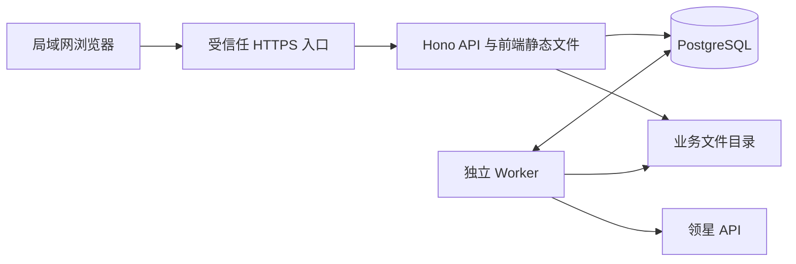
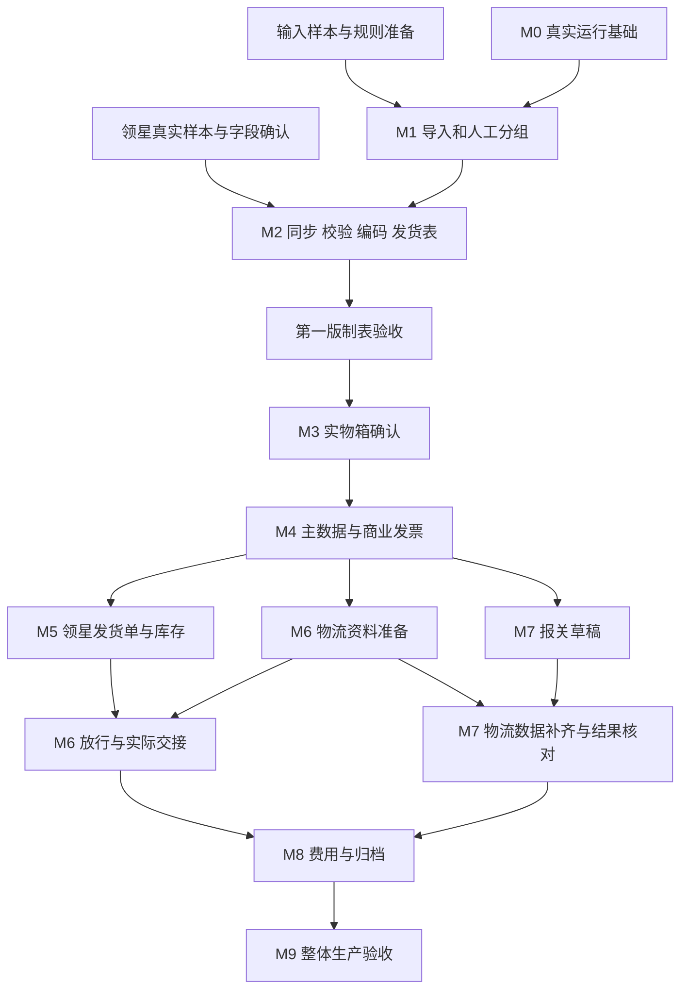

# 前后端正式建设详细计划

## M2/M3 拆分与 M4 当前交付（2026-10-19）

M2 已恢复独立四步向导，发货表不依赖 M3；M3 已有独立分页、筛选和历史工作区，旧入口兼容。M4 首期已实现丰信 B2B 单票 XLSX 的资料/模板版本、批量资料预检提交、按本周完整 FBA 分票、草稿补录、校验、Worker 生成、复核、取消、更正和历史。下面旧“五步向导”“完整 B2B 留待后续”“M3 未实现”是历史阶段描述，以本节、[M4 计划](./M4%20PLAN.md)、[当前状态](./implementation-status.md)和共享契约为准。技术交付不代表接收系统实际导入或真实批次人工签收通过，独立商业发票及其他报关文件仍留待后续。

## M3业务决定补充（2026-10-18）

用户已确认领星登记值/标准箱规为取数依据、货箱重量采用毛重口径，另行实测与领星冲突时以领星为准；输出KG/CM，使用Decimal换算后ROUND_HALF_UP到两位，原值及原单位完整保留。PO Number等于逐FBA的Reference ID，货箱编号为`FBA号 + "000001-" + 该FBA实际箱数`，按内部箱ID去重，保留独立逐箱UUID和原平台标识。详见[业务规则及来源边界](./business/rules.md#m3取值依据与确认规则2026-10-18)。

《M3 PLAN.md》已确定舍入、无额外容差、缺项阻塞、逐箱草稿、整组确认和失效规则；独立 M3 来源、核对、批量模板及标准三表 XLSX 已交付，入口已从旧五步流程分离。首期丰信 B2B 由 M4 实现。官方接口和归档值不能替代现场核对；真实批次及明确签收 pending，既有 T13/T22/T23 未验事项仍分别保留。接口见[M3 API](./api/physical-review.md)，结果见[M3技术验收（私有记录说明）](./acceptance/evidence/README.md)。

## 发货管理整合补充（2026-10-18）

需求导入、发货批次和发货成品表已整合为 `/shipping` 工作区，通过左侧“发货管理”的三个子项切换，保留同页筛选和向导草稿；原详情及处理深链接继续可用。右侧标签导航已移除，父菜单支持展开收起和折叠侧栏、手机菜单。设置位于侧栏底部和手机顶栏账户区。操作与恢复边界见[运行说明](./operations.md#发货管理工作区2026-10-18)，隔离界面回归入口为 `corepack pnpm shipping:browser`。

## 需求导入工作区改造补充

本轮增加 `/imports` 需求全集工作区：筛选、导入/导入记录/刷新操作栏，以及参考月表字段顺序的商品与逐箱明细。未分组或未取数需求保留占位，候选与确认/冻结快照分别展示。在线填写支持Excel粘贴、FBA基本信息补全及显式确认提交，快照保存为不可变XLSX；原文件导入流程继续可用。

FBA补全查询当前可用店铺与指定货件创建日期范围，唯一匹配后带出店铺、国家、目的FC、目的地址和创建时间；头程业务渠道由人工维护。商品与装箱仍在分组后同步，正式确认、编码、导出规则继续由批次模块执行。所有外部操作保持只读。

接口及兼容规则见 [导入API扩展](./api/imports.md)。真实在线导入链路见 [工作区集成验收（私有记录说明）](./acceptance/evidence/README.md)，真实跨店铺FBA查询见 [只读查询验收（私有记录说明）](./acceptance/evidence/README.md)。

版本：1.9。更新日期：2026-10-18。业务时区：`Asia/Shanghai`。系统仅保留管理员账户。T12及T14–T21已实现完整只读制表；T13/T22资料预检、对账、版本包和显式人工签收工具，以及当前电脑的T23独立试用部署、HTTPS及备份恢复已建设，本轮另补充M3取值决定。真实后续文件和待签批次资料尚未提供，完整T13/T22及T23验收继续受实际材料、用户签收、整机重启、独立客户端和备份介质约束。具体结果见[本轮验收（私有记录说明）](./acceptance/evidence/README.md)。下文旧阶段缺口保留为历史安排，不作为当前未实现结论。

建设从现有 M0 基础代码继续推进，先完成“需求导入 → 人工分组 → 领星只读同步 → 数量核对 → 编码 → 发货表导出”的完整操作路径，再建设实物箱确认、商业发票、物流交接、报关和费用闭环。每个阶段同时交付页面、接口、数据保存、异常处理和验收证据。

2026-10-17用户补充边界：店铺设置可切换领星实际数据（默认）与人工维护，人工数字代码仍真实sid。最终交付必须包含类似附件月汇总、美国/欧洲批次页的前端商品/逐箱表格和XLSX导出；T10–T11导入清单不算该成品。整个此流程仅获取领星数据，不自动写回领星；本计划旧“领星写入”安排暂停，不作为后续自动动作，详见[最终目标与只读边界](./business/store-sources-and-output-target.md)。

本计划用于安排开发；业务语义以 [已确认业务规则](./business/rules.md) 为准，字段来源以 [字段映射](./business/field-mapping.md) 为准。待确认事项经业务负责人决定后写回对应业务文档，不能仅在本计划或代码里形成默认规则。[原实施方案](./发货全流程自动化系统实施计划-技术栈重设计版.md)保留整体业务目标，模块实际完成情况记录在 [开发状态](./implementation-status.md)。

## 一 当前建设起点

### 已有能力与实际缺口

| 范围 | 当前实际情况 | 建设处理 |
| --- | --- | --- |
| 项目组织 | 已有 `apps/web`、`apps/server`、`packages/contracts` 和 pnpm workspace | 复用单仓结构，按模块扩展 |
| 前端 | 登录/工作台、店铺维护及上传/解析/映射确认/差异/提交/需求版本与来源 | T12及M2页面已实现，进入真实业务签收 |
| API | M0、店铺维护、导入/解析/差异/提交/历史、需求详情及授权原件/错误清单下载 | 复用独立模块，后续扩展批次及同步 |
| 数据库 | M0/店铺表、导入5表及需求/版本/来源/预览/提交5表 | 后续为批次、货件、箱及文件导出增加迁移 |
| Worker | M0事务入队与心跳，以及T09独立解析、管理员身份/对象复核、短事务发布和失败对账 | 后续补齐同步/导出等业务任务及逐项结果 |
| 文件 | 不可变文件、哈希和索引；T09原件关联、受控上传及授权下载已实现 | 后续扩展导出生成及文件清理对账 |
| 共享契约 | 管理员身份、示例任务、店铺维护、上传解析及需求差异/提交/版本/来源schema | 按后续模块补齐批次和同步契约 |
| 领星探测 | 已有独立探测和解析测试；真实样本与统计私有保存 | 正式分页、续约、各类货件和生产流程须独立验收 |
| 业务资料 | 已有 SOP、历史发货表、装箱规格、物流及报关样本和研究记录 | 建立样本清单，确认正式模板、原始输入和适用范围 |
| 业务规则 | 首版边界、子批次、数量守恒和编码规则已有基线 | 实现并形成可回归的业务案例 |

代码依据：[前端路由](../apps/web/src/main.tsx)、[页面](../apps/web/src/pages.tsx)、[API](../apps/server/src/app.ts)、[schema](../apps/server/src/db/schema.ts)、[任务](../apps/server/src/tasks.ts)、[Worker](../apps/server/src/worker.ts)、[共享契约](../packages/contracts/src/index.ts)。

### 本次可确认的运行与证据状态

- 已建立本地 Git 仓库及 `pre-m0-baseline`，私有资料和运行数据保持忽略；当前版本与验收以 implementation-status 为准。
- Node.js 24.22.0、Corepack 0.36.0、pnpm 12.11.2 和 Git 2.53.0.windows.3 已复现；Git 未在当前 shell PATH 时使用运行时附带可执行文件，不据此认定缺少仓库。
- 已按锁文件安装并完成 M0 workspace 检查；后续切片重新运行相关检查，不以 node_modules 目录存在作为成功依据。
- 已配置受控 `.env`、独立 PostgreSQL、受控私有 DATA_DIR；M0 真实登录、事务、文件及 API/Worker 恢复通过。本机业务人工签收、目标设备 HTTPS/自启/独立恢复仍待验。
- `scripts/lingxing/.env` 仅用于已授权的本地只读探测，密钥不写入文档。最新文档整理没有新增 API 请求。
- 真实报告和参考抽样仅在受控本地保存，公开版本不包含业务清单或数量；历史取数不等于完成正式模块或业务签收。
- Node.js 24.19.0 下的独立脚本测试已更新为18项通过，包含boxName兼容；本地测试证明解析行为，真实样本证明已测字段可读，两者均不能替代生产端到端验收。
- M0 的本机真实数据库与浏览器证据已取得；本轮新增店铺映射切片的验证单独记录，不能据此扩大真实需求导入或生产验收范围。

## 二 交付范围与版本顺序

| 交付阶段 | 对应模块 | 可实际使用的结果 | 进入下一阶段的条件 |
| --- | --- | --- | --- |
| 基础可运行 | M0 | 登录、权限、数据库、任务、文件和重启恢复联调通过 | M1 原始输入可解释，基础运行稳定 |
| 第一版制表 | M1 与 M2 | 导入需求、人工分组、只读取数、数量确认、编码、发货表导出 | 代表性历史样本和一个真实批次对账通过 |
| 箱确认与单据 | M3 与 M4 | 实物箱确认、重量尺寸、申报主数据、正式商业发票和单据版本 | 真实单据逐字段复核通过 |
| 出货与物流 | M5 与 M6 | 受控领星写入、库存分配、物流文件、订单箱唛、放行及交接 | 逐单结果可回查，异常与取消可恢复 |
| 申报与费用 | M7 与 M8 | 报关及 9810 结果登记、账单分摊、费用回填和批次归档 | 有效成员的外部结果与费用闭环 |
| 整体生产验收 | M9 | 目标 Windows 部署、连续真实批次、备份恢复和维护交付 | 完整生产交付清单通过 |

第一版只调用领星查询接口。飞书仍由人员导出 Excel；物流文件由人员上传；报关和 9810 在现用平台由单证人员提交。直连飞书、回写“已拿”、自动控制打印机、自动操作报关平台属于后续明确立项的扩展。

需求也可采用业务人员按确定模板整理后手动上传的路线，记录为人工来源，不要求先接入飞书 API。该路线仍需要实际字段、行粒度及后续新增/更正样本；店铺映射保存在数据库主数据中，登录账号沿用现有 Better Auth 数据库。具体输入确认见 [T05 输入确认](./business/feishu-intake.md)。

第一版的数量确认是制表数据确认；M3 增加线下实物、重量尺寸和出货用途的确认。前者不能自动标记为已完成实物核验。标签打印先保留现有领星流程，系统记录打印和贴标事实。

## 三 正式开工前的准备与决定

### 进入条件按功能分别执行

M0 环境工作可以立即开始；M1 正式导入需要原始输入与字段规则；M2 正式同步需要真实账号样本；M4 正式文件需要主数据与模板。缺少某一渠道资料只阻塞相应功能或渠道，其他已满足条件的工作继续推进。

| 编号 | 必须准备或确认的内容 | 负责角色 | 阻塞范围 | 完成产物 |
| --- | --- | --- | --- | --- |
| D01 | 开发机与目标部署机、Node/pnpm/PostgreSQL、数据目录和受控版本管理 | 开发、管理员 | M0 运行验收 | 环境清单、版本记录、启动说明 |
| D02 | 已指定附件“飞书表格”为首份解析样本、“示例第X批”为输出参考；仍需之后一次新增/更正文件 | 运营 | 真实增量提交与端到端验收；不再阻塞核心上传/解析契约 | 脱敏样本、字段映射、预期变化 |
| D03 | 来源稳定行标识；缺少行 ID 时采用什么业务键及如何处理歧义 | 运营、开发 | M1 增量提交 | 来源匹配规则及歧义案例 |
| D04 | 业务日期已定为上海导入日期；跨年周显示和既有需求跨周更正仍待定 | 运营、开发 | 未定项只约束跨年显示与更正；可先展示周起止日期 | 固定importedAt/businessDate及周范围，异步确认/重试不改日 |
| D05 | 全部目录店铺均使用；别名到sid、国家、站点及适用wid逐项核对 | 运营、接口维护者 | 实际别名确认、未测店铺取数与库存备注 | 维护页面已交付；保留候选审批与冲突清单 |
| D06 | 固化已取得的STA报告、补足非STA/其他国家/异常/变更与至少20票覆盖；按预算少量采样 | 接口维护者 | M2 正式同步验收 | 脱敏报告、原始响应、账号能力记录及未验清单 |
| D07 | 主数量采用哪个确认口径；详情、申报、本地已发货、接收量分别如何对照 | 运营 | M2 正式确认和导出 | 数量口径规则及差异处理例子 |
| D08 | boxName别名和编号域已有样本；确认跨次稳定性、正式箱排序、修改/缺箱号和非STA处理 | 运营、接口维护者 | M2 箱映射和编码 | 两次查询对照、变更和异常恢复样例 |
| D09 | US/EU 导出列语义、超过十箱、混装、跨箱、汇总和状态展示 | 运营 | M2 正式发货表 | 正式模板版本、一份人工确认成品 |
| D10 | 已确认未导出组的合并拆分、撤销确认、编码失效与更正规则 | 运营 | 对应变更动作 | 操作前后示例、旧码失效范围 |
| D11 | 本计划已确定领星值优先、毛重、KG/CM后ROUND_HALF_UP两位、无额外容差、必要字段缺项阻塞、Reference冲突及整组重核规则 | 管理员、线下负责人 | M3真实签收 | 规则已收口；真实逐箱检查表及明确签收pending，不能以API字段可取代替实物复核 |
| D12 | 商业发票、清关单、物流 B2B 三类文件的区别、正式模板及所需格式 | 单证、物流对接 | M4/M6 正式生成 | 模板清单、目标接收方、确认样例 |
| D13 | 商品申报、主体、地址、价格币种、税务和国家渠道配置 | 单证、运营 | M4/M7 正式复核 | 有生效版本的主数据与规则 |
| D14 | 创建、分配、释放、确认发货、备注、费用更新的账号权限与回查能力 | 接口维护者、运营、财务 | M5 及后续外部写入 | 每个动作的输入输出、限制、失败与未知恢复证据 |
| D15 | 物流返回、箱唛关联、部分交接、放行顺序和交接凭据 | 物流对接、运营 | M6 放行与交接 | 一套实际交接案例 |
| D16 | 报关/9810 状态、单位、净重、订单号和成功或退回凭据 | 单证 | M7 | 平台流程、字段映射和结果样本 |
| D17 | 原始账单、费用分类、计价范围、币种、分摊精度及尾差 | 财务 | M8 | 账单和人工已核对的分摊结果 |

### 已确定规则直接进入实现

1. 使用 `Asia/Shanghai`，以导入文件成功接收时的上海日期作为业务日期，保存后解析/确认/重试不改日。周一至周日，数据库用周起止日期标识，跨年名称未定时直接显示日期范围；不用旧表或API日期归周。
2. 没有来源分组标识时由人建立子批次。相同商品、箱配方或日期不能成为自动合并依据；P/Q 不同 FBA 集合保持独立。
3. FBA 去首尾空格并转大写，按纯文本排序。后台以 `sid + FBA` 识别货件，sid 不明时提示选择，不能猜店铺。
4. 商品身份保存 sid、FBA、MSKU、FNSKU、SKU；箱使用稳定内部 ID，展示码与平台箱号分别保存。
5. 商品总量等于逐箱该商品数量之和；缺值保持缺值，合法的零与缺失分别处理。数量不守恒阻止正式导出。
6. 编码在周批次内使用 `A…Z、AA…`；组内按实际箱数编号，追加不重排已确认编码。
7. 已导出或已打印的子批次禁止直接移动、合并、拆分和追加。后续更正创建新版本并保留原事实。
8. 异常只阻止受影响子批次；同周其他已确认子批次可以继续。

### 模板专项验证

已有发货记录模板可复用，不能把“所有模板都没有”列为阻塞。现有核验指出：V 列“重量”在美国样本中实际承载商品数量汇总，欧洲样本中还有“完成”状态；D 列实际是目的 FC。先确认字段语义，再编写输出适配器。[模板核验记录（私有研究说明）](./research/README.md)

`.xls` 样本必须单独验证格式路线。ExcelJS 的公开 I/O 说明面向 XLSX 和 CSV；不能据此承诺直接处理旧 XLS。首选取得正式 XLSX 模板或经业务核验的转换版本；接收平台若强制要求 XLS，再验证独立兼容适配器和实际导入结果，不能只改扩展名。[ExcelJS 官方说明](https://github.com/exceljs/exceljs#file-io)

## 四 技术架构与代码组织

### 延续现有架构

采用 React/Vite 前端、Hono API、PostgreSQL、Drizzle、pg-boss 独立 Worker、Better Auth 本地管理员账号、受控私有业务文件目录。运行规模沿用单仓、每周约 1000 箱以内的项目基线；2026-10-17起仅保留管理员账户，原多角色分工不再作为开发或验收前提。

当前 package 声明为 React `^19.3.0`、Vite `^8.3.4`、Hono `4.13.13`、Drizzle `0.45.4`、pg-boss `12.37.1`、Better Auth `1.7.7`、Node `>=24 <25`、pnpm `12.11.2`。这些是仓库声明，不代表本环境已经完整安装或兼容性已验收。M0 按锁文件安装并记录实际版本，不随意升级整套框架。



### 分层职责

| 层 | 负责内容 | 实现要求 |
| --- | --- | --- |
| 页面与组件 | 输入、预览、选择范围、状态及差异展示 | 业务是否允许执行由服务端最终判定 |
| 共享契约 | Zod schema、DTO、错误码、状态、分页及十进制字符串 | 不引入数据库、文件路径或服务端密钥 |
| 路由 | 登录、动作权限、请求校验、响应和 traceId | 避免在路由中堆积算法、文件生成和长耗时逻辑 |
| 业务服务 | 状态转换、数量校验、版本冻结、确认和事务 | API 与 Worker 共用，同一规则只有一个正式实现 |
| 数据访问 | 查询、唯一约束、索引、迁移、并发更新 | 数据库约束与应用校验共同维护不变量 |
| 集成适配器 | 领星签名、token、限流、分页及响应解析 | 原始响应先留存，业务确认数据单独保存 |
| Worker | 解析、同步、校验、导出、回查 | 保存进度，允许重复执行时得到一致结果 |
| 文件服务 | 原文件、模板、导出、附件和凭据 | 文件不可变、索引可追溯、下载需授权 |

### 按需扩展目录

```text
apps/web/src/
  app/                     路由、会话、QueryClient、外壳
  features/
    imports/               上传、字段映射、预览、提交
    batches/               周批次、子批次、货件、编码
    boxes/                 箱商品明细、实物确认
    documents/             模板、主数据、单据、复核
    logistics/             订单、箱唛、放行、交接
    customs/               报关及9810登记
    finance/               账单、分摊、回填
  components/              共用表格、状态、差异、任务和确认控件
  lib/                     API客户端、格式化和查询键
apps/server/src/
  modules/
    imports/ batches/ shipments/ boxes/
    lingxing/ documents/ logistics/ customs/ finance/
  jobs/                    任务入口与逐项执行
  shared/                  权限、审计、文件、错误、版本
  db/                      schema、连接、迁移执行
packages/contracts/src/
  common.ts imports.ts batches.ts shipments.ts boxes.ts
  tasks.ts documents.ts logistics.ts customs.ts finance.ts
docs/
  development-plan.md      本计划
  api/                     随模块新增的接口说明
  acceptance/              场景与验收证据
```

每个业务模块按实际复杂度拆 `routes`、`service`、`repository`、`schema` 或算法文件；小模块不强制创建空层。现有 `pages.tsx`、`app.ts`、`worker.ts` 随首个业务模块逐步拆分，避免一次大规模重写。

### 依赖补齐顺序

- M0：复现现有锁文件，配置检查与测试入口；补齐业务 E2E 所需 Playwright。
- M1上传：已锁定fflate 0.8.2、fast-xml-parser 5.3.8及yauzl 3.4.0（类型3.4.0），以保留原始OOXML类型与公式缓存状态并逐流限制解压；本轮不引入ExcelJS。后续生成XLSX再按导出需求决定库。复杂表格/表单依赖按实际需要补齐。
- M4：按正式模板格式决定是否引入 docxtemplater/PizZip，以及 PDF 生成或转换工具。PDF 预览和 PDF 正式成品分别验收。
- 每次增加依赖同步提交锁文件，验证 Node.js 24、Windows 和构建兼容性。

## 五 前端页面与交互建设

以下路由为拟定契约；除现有 `/`、`/login` 外均需实现。批次详情使用稳定 ID 和标签页，可保存链接直达具体对象。

| 页面或路由 | 主要内容 | 关键操作 | 实施阶段 |
| --- | --- | --- | --- |
| `/` | 真实业务待办、异常、任务及服务状态 | 导入需求、进入具体待办 | M0，随模块替换示例统计 |
| `/imports/new` | 上传、工作表、字段映射、解析进度 | 上传、重新解析 | M1 |
| `/imports/$importId` | 原始行、规范值、错误、增量和成功范围 | 修正映射、选择提交、下载错误清单 | M1 |
| `/batches` | 周范围、状态、负责人、店铺和渠道筛选 | 新建或进入周批次 | M1 |
| `/batches/$batchId` | 周批次概览、子批次、源行和成员 | 人工分组、排序、合并拆分、追加 | M1 |
| 批次内货件与商品页 | FBA、商品身份、多口径数量、来源时间 | 同步、查看逐票结果、处理差异 | M2 |
| 批次内编码与发货表页 | 子批次顺序、箱码、逐箱数量、导出版本 | 校验、确认、编码、导出 | M2 |
| 批次内箱数据页 | 箱列表、箱内商品、重量尺寸、来源和版本 | 补录、实物确认、查看版本差异 | M3 |
| `/documents` 与单据详情 | 文件类型、成员、版本、复核、失效和替代关系 | 预览、下载、生成、复核或退回 | M4 |
| 所属模块的档案与规则页 | 商品、主体、地址、国家渠道、税务及模板 | 草稿编辑、生效、停用、版本查看 | M4 起 |
| 批次内领星页 | 外部单据、库存及操作结果 | 预览写入、确认执行、回查、人工登记 | M5 |
| 批次内物流与交接页 | 文件、订单、箱唛、放行条件、交接范围 | 导出、回收结果、放行及登记 | M6 |
| 批次内报关页 | 资料组、报关与9810两个流程、凭据 | 生成、复核、反馈修订、结果登记 | M7 |
| `/finance` 与批次费用页 | 账单、归属、分摊、拟回填及回查 | 确认分摊、回填、补账、归档检查 | M8 |
| `/tasks/$taskId` 或共用详情面板 | 总进度、逐项结果、错误、重试和关联对象 | 查看、对失败项恢复、回查未知结果 | M0 至 M8 |

### 共用交互先做哪些

1. 从已有 Neo 页面提取外壳、登录保护、页面标题、提示和错误处理；保留现有色彩、焦点与窄屏规范。
2. 建立服务端分页表格、筛选、勾选范围、列显隐、稳定行键和横向滚动。跨页选择必须明确是当前页还是全部筛选结果。
3. 建立差异视图，逐字段展示来源值、当前确认值、拟采用值、影响范围和源行；确认提交绑定预览版本。
4. 建立任务进度、逐项失败、重试、结果下载和服务离线反馈。刷新页面后可以回到原任务。
5. 建立确认面板，展示具体对象、数量或金额、版本及影响；更正、重复保留、外部写入等动作记录原因。
6. 统一 401、403、409、422、503 的展示；版本冲突引导刷新核对，不能自动覆盖。

表单本地草稿只保存非敏感的界面偏好或临时输入；业务确认结果必须持久化到服务端。查询键包含对象 ID、筛选条件及必要版本，变更成功后刷新受影响数据。轮询采用任务进行中启用、完成后停止、失败时退避的方式。

每页覆盖加载、空数据、请求失败、无权限、待确认、部分失败、结果未知和离线状态。未交付模块的入口保持明确的未开放状态，不填充虚构统计。代码现用 `Asia/Hong_Kong` 的日期格式统一迁移为 `Asia/Shanghai`。

### 图标与动效统一（2026-10-18）

现有页面沿用 Lucide 和 CSS：通用刷新、关闭、分页、表格查看/维护与已有文件下载采用图标按钮，提供至少 44×44px 点击区、中文可访问名称及悬停/键盘提示；链接保持真实导航语义。导入、保存、同步与确认等业务操作保留文字。会清空草稿或确认的刷新，以及生成 XLSX、登记打印、合并拆分、分配编码等影响版本的操作，保留完整说明和原业务约束。

共享 `Button` 提供 `icon`、`loading`、`loadingLabel`；动态加载文案用双层占位保持按钮尺寸。`IconButton` 和 `IconLink` 必须指定 `label`，行对象信息通过 `description` 补充。按钮状态过渡约 150ms，弹窗与主动切换内容约 200ms；原生弹窗退出动画渐进增强，旧浏览器即时关闭。导入面板保持挂载，轮询不重播内容动效；系统减少动画时关闭位移和旋转，保留真实状态文字。

运行 `corepack pnpm ui:browser` 验证需求导入、登录/工作台/店铺和批次/成品表。三个脚本启动独立 Vite 并拦截 API，以内存样例验证图标语义、加载防重复、提示、焦点、草稿保留、轮询稳定和窄屏布局，不使用真实账号、数据库或领星服务。默认使用本机 Chrome，可设置 `IMPORT_BROWSER_CHANNEL=msedge`；报告和截图分别在 `.local/t24/frontend/`、`.local/t24/shell-icons/` 和 `.local/t24/batch-icons/`。界面回归不替代真实业务签收。

## 六 后端接口与共享契约

### 通用约定

以下为新增业务接口约定，现有 Better Auth 协议与现有接口逐步兼容：

| 内容 | 约定 |
| --- | --- |
| 前缀 | `/api/v1`；查询使用 GET，业务动作用明确的 POST 子路径 |
| 主键 | 稳定 UUID；FBA、箱码、店铺名和文件名作为业务字段 |
| 时间 | importedAt用带时区ISO字符串；businessDate取首次成功接收本次文件时的上海日期YYYY-MM-DD，持久化规则版本；重放与异步确认保持原日期 |
| 数值 | 商品件数按已确认单位校验；金额、重量、尺寸和汇率用十进制字符串传输 |
| 分页 | `page`、`pageSize`、白名单排序及稳定第二排序键；返回 items 和 total |
| 版本 | 修改请求带 `expectedVersion`；更新影响行数为零时返回 409 |
| 幂等 | 关键提交带 `operationId`；同 ID 同请求返回已有结果，不同请求返回冲突 |
| 异步 | 202 返回 taskId 和查询入口；受理不等于执行成功 |
| 错误 | `error.code`、`message`、`details`、`traceId`；字段错误定位到字段、源行或对象 |
| 权限 | 每个路由检查动作权限，Worker 执行前再次校验权限与输入版本 |
| 文件 | multipart 上传不套用现有 JSON 请求头；下载通过受控 fileId，服务端解析存储路径 |

错误分类至少包括 `VALIDATION_ERROR`、`FORBIDDEN`、`VERSION_CONFLICT`、`OPERATION_CONFLICT`、`SOURCE_MAPPING_REQUIRED`、`SHIPMENT_NOT_FOUND`、`INCOMPLETE_PAGINATION`、`QUANTITY_MISMATCH`、`BOX_ID_UNRESOLVED`、`CONFIRMATION_STALE`、`EXPORT_BLOCKED`、`EXTERNAL_RESULT_UNKNOWN`。

### 首版接口清单

下列路径是待实现的设计；开工时把完整请求和响应 Zod schema 写入 contracts，并补充对应 `docs/api/` 说明。

| 接口 | 业务含义 | 前置检查 |
| --- | --- | --- |
| `POST /imports` | 保存原文件、创建解析任务 | 文件类型、大小和上传权限 |
| `POST /imports/:id/parse` | 按工作表与映射版本解析或重新解析 | 原文件有效、映射合法 |
| `GET /imports/:id` 及 `/rows` | 解析进度、分页行、错误与差异 | 查看权限 |
| `POST /imports/:id/commit` | 提交选定有效范围 | 解析/映射版本、operationId、成员选择 |
| `GET /weekly-batches` 及 `/:id` | 周批次列表与概览 | 筛选与分页合法 |
| `POST /weekly-batches/:id/sub-batches` | 建立人工分组 | 店铺映射、同周唯一成员 |
| `POST /sub-batches/:id/members`、`/merge`、`/split` | 成员追加、合并与拆分 | 版本、状态及已导出/打印冻结 |
| `POST /weekly-batches/:id/reorder` | 保存子批次人工排序 | 排序版本及已分配编码约束 |
| `GET /seller-accounts` | 店铺及授权状态映射 | 映射来源与更新时间可查 |
| `POST /sub-batches/:id/sync` | 创建只读同步任务 | sid/FBA、范围及输入版本 |
| `GET /shipments/:id` 及 `/items`、`/boxes` | 货件、商品及箱明细 | 区分最新候选和已确认版本 |
| `GET /sub-batches/:id/issues` | 查询差异和阻塞项 | 返回业务定位信息 |
| `POST /issues/:id/resolve` | 记录补录、采用值或重复处理决定 | 原因、证据、版本；处理后重新校验 |
| `POST /sub-batches/:id/validate`、`/confirm` | 校验并确认制表数据 | 数量、成员、身份及快照完整 |
| `POST /sub-batches/:id/allocate-codes` | 为确认范围分配编码 | 周内锁、唯一约束及冻结规则 |
| `POST /sub-batches/:id/exports` | 异步生成发货表 | 确认/模板/规则版本有效 |
| `GET /sub-batches/:id/exports` | 导出历史及有效状态 | 文件与数据版本可查 |
| `GET /tasks/:id` 及 `/items` | 通用任务和逐项结果 | 对象访问权限 |
| `POST /tasks/:id/retry` | 恢复允许重试的失败范围 | 不重放成功或未知写入项 |
| `GET /files/:id/download` | 下载授权业务文件 | 关联范围及角色检查 |

M3增加独立来源采集、核对草稿、实测差异、整组确认、批量模板及标准明细导出接口，见[M3契约](./api/physical-review.md)；M4增加档案、规则、模板、单据组与复核；M5–M8分别增加外部操作、物流交接、报关结果和费用接口。后续模块只提前定义边界，不创建没有实现的成功响应。

通用任务替代示例任务时，同步迁移首页、`/tasks` 返回结构、前端解析器和 contracts。现有客户端只识别四种任务状态，新增“部分成功”等状态需要兼容处理后再开放。

## 七 数据库与版本设计

### 分阶段新增实体

以下是迁移设计清单，不代表已建表；确切表名和字段在对应模块开工时定稿。

| 阶段 | 数据实体 | 主要用途 |
| --- | --- | --- |
| M0 | 扩展 audit、file_index；新增通用 task、task_item 和 operation 记录 | 保存业务任务、逐项结果、权限关联及提交幂等 |
| M1 | source_import、source_import_row、source_mapping_version、demand_revision | 原文件、源行、映射、需求增量和确认版本 |
| M1 | seller_mapping/seller_alias/seller_mapping_revision（已实现）；weekly_batch、sub_batch、shipment、sub_batch_shipment（待实现） | 店铺、周范围、人工组及稳定货件身份；后续复用已建店铺ID |
| M2 | sync_run、sync_item、sync_snapshot | 逐票/逐页响应、完整性与续跑记录 |
| M2 | shipment_revision、shipment_item、box、box_revision、box_item | 稳定实体与各次数据版本，支持历史重现 |
| M2 | validation_issue、manual_decision、confirmation、allocation_code、export_version、print_record | 差异、决定、确认、编码、导出与打印事实 |
| M3 | physical_source、physical_revision、physical_confirmation、独立采集及导出记录 | 来源、实测、核对、确认及M2依赖分开保存；模板／预检绑定服务器manifest，历史不覆盖 |
| M4 | product_declaration、party_profile、address_profile、channel_rule、tax_rule、declaration_rule、template_version | 商品及主体档案、规则和模板版本 |
| M4 | document_group、document_member、document_revision、review、dependency_reference | 单据成员、文件、复核和上游版本依赖 |
| M5 | external_operation、external_operation_item、external_document_link、inventory_snapshot、allocation_result | 外部动作、逐单结果、库存与单号关联 |
| M6 | logistics_order、logistics_member、transit_rule、release_check、handover、handover_box | 物流订单、时效、放行及实际箱交接 |
| M7 | customs_group、customs_record、order_9810_record、external_result_evidence | 报关及9810各自状态、编号和证据 |
| M8 | bill、bill_line、cost_allocation、finance_confirmation、fee_writeback、archive_check | 原账单、分摊、回填和归档条件 |

### 需要在首版落实的约束

1. **货件唯一性与周归属分开。** `sid + normalized_fba` 是稳定货件键；同一周只能存在一个有效子批次成员。跨周再次导入提示既有归属和差异，不自动复制准备数量。
2. **业务唯一性落实到数据库。** 周范围唯一、同周有效货件成员唯一、周内前缀唯一、确认版本内箱码唯一。并发冲突返回业务错误，不能仅靠页面防重复。
3. **商品版本完整关联。** 箱内商品必须属于同一货件和对应数据版本。候选行缺少商品身份时先存异常区，不伪造主数据键。
4. **箱 ID 不由数组下标生成。** 首次建立内部 ID，记录外部箱号与匹配依据；再次同步不能可靠对应时进入差异核对，不静默重建已编码箱。
5. **历史版本可复现。** `shipment` 可保存最新指针，但确认、编码、单据和导出必须绑定不可变数据版本。后续同步不能通过修改全局“当前货件”改变旧周批次的事实。
6. **源行号用于追溯。** 文件哈希、sheet 和源行用于定位；业务去重需稳定来源 ID 或经确认的业务键。重复上传同文件幂等，不同文件中同货件合法多商品行保留。
7. **编码分配需要事务。** 在周批次范围串行分配前缀和箱序；作废编码保留，是否复用遵循确认规则，默认不自动回收复用。
8. **数量与测量值分开。** 需求量、当前/初始申报量、计划箱合计、实物确认量、本地已发货量、接收量分别存储；领星重量、实测毛重、物流毛重和计费重分别存储。
9. **十进制与单位明确。** 金额/重量采用 NUMERIC，服务端计算用 decimal.js；原始值与单位保留，转换绑定规则版本。
10. **确认必须可追责。** 保存 actor、时间、范围、版本、原因和附件；关键更正记录旧值、新值及关联文件。

### 状态按对象分开维护

| 对象 | 拟定状态 | 核心限制 |
| --- | --- | --- |
| 导入 | 已上传、解析中、待映射、待确认、部分提交、已提交、失败 | 解析成功不自动提交需求 |
| 业务任务 | 排队、执行中、部分成功、成功、失败、取消 | 任务状态不能代替业务确认 |
| 子批次数据 | 待分组、待同步、有差异、待确认、已确认 | 导出与打印另存事实及冻结标记 |
| 文件版本 | 生成中、草稿、待复核、有效、失效、被替代、生成失败 | 已生成不等于已复核 |
| 箱实物确认 | 待补齐、待复核、已确认、确认失效 | 必填测量和数量缺失时不得确认 |
| 外部动作 | 待执行、执行中、已受理待查、核实成功、明确失败、结果未知、需人工核对 | 未知结果先查后决定，不直接重发 |
| 实际交接 | 未交接、部分交接、已交接、有差异 | 交接事实不从领星状态推断 |

每个动作列出允许的起始状态、权限、必填字段、版本条件和失败结果，并在服务层维护。跨模块总进度由成员事实汇总，不能用一个“完成”字段覆盖所有流程。

## 八 异步任务与领星集成建设

### 任务基础

任务记录至少保存类型、范围、operationId、请求哈希、输入版本、提交人、排队/开始/结束时间、进度、成功/失败项、错误和输出 fileId。逐项结果采用稳定业务键，任务重试后能识别已完成项。

业务变更与入队继续使用同一数据库事务。Worker 的网络请求和文件生成不放在长数据库事务内：先领取与登记执行，再执行外部工作，最后用短事务保存结果和核对输入版本。生产业务任务不能原样复制示例 Worker 的长事务处理方式。

pg-boss 的官方说明要求处理程序适应至少一次投递，并支持业务事务内入队。因此“重启不重复产生业务效果”由操作 ID、数据库唯一约束和结果回查共同实现，不能把队列当作外部操作只执行一次的保证。[pg-boss 官方说明](https://pgboss.io/introduction#what-to-expect)

### 领星只读集成步骤

1. 将探测脚本中的签名、脱敏、响应判断、分页检查和分析规则提炼到服务端集成模块；脚本继续作为独立诊断入口，避免两套签名实现漂移。
2. 增加服务端配置校验、token 生命周期与安全存储、过期判断和刷新互斥；明确同 AppId 是否已有其他接入方管理 token。
3. 按 AppId 与接口路径协调并发，覆盖 API 进程、Worker 和诊断脚本同时运行的情形。具体 token 刷新和限流规则以正式接入时核对的官方文档及账号行为为准。
4. 先同步店铺和授权状态，再按已确认 sid/FBA 查询货件列表、详情和装箱。旧货件查询覆盖真实创建日期，检查分页完整性。
5. 每次请求保存脱敏参数摘要、响应快照、哈希、时间、HTTP/业务错误、重试和分页检查结果；token 不进入快照与日志。
6. 逐票重建货件、商品、箱和箱内商品，按商品身份做数量核对；不同商品一增一减即使总件数相同也必须发现差异。
7. STA/非 STA、缺字段、空装箱、缺箱号、重复页等逐项记录；回退 Excel/补录也保留来源并重新校验。
8. 可选库存只查指定成品仓，分页后按 SKU 精确筛选；显示查询时间。多票相同 SKU 共用一份库存快照，不视为已预留库存。

现有脚本不实现长期 token 续约、数据库持久同步或业务导出，不能直接通过加定时调用完成生产接入。接口依据见 [能力记录](./integrations/capabilities.md)、[探测说明](./integrations/lingxing-probe.md) 和 [领星官方接入入口](https://apidoc.lingxing.com/new/)。

### 外部写入在 M5 前必须补齐

- 操作预览绑定业务范围、请求哈希、输入和复核版本；服务端和 Worker 均检查功能开关、账号权限与有效版本。
- 同一外部单据写入串行，批量动作逐单保存结果；成功项不能因其他项失败而丢失。
- 超时或受理后断线记为待查/未知；先按业务键或操作标识回查。没有可靠回查或去重能力的动作保持人工流程。
- 取消先核对外部状态和库存释放方式；已发生的发货、交接和申报事实保留，更正另存。
- 只读请求按错误类别有限重试；权限、结构错误和业务校验失败不通过循环重试掩盖。写入不沿用通用网络自动重试策略。

## 九 按模块实施的详细工作

### M0 完成真实运行基础

**进入条件：**已有代码、开发机与目标机范围明确。数据库凭据在受控环境配置。

| 工作面 | 必须完成的工作 |
| --- | --- |
| 环境 | 建立版本基线；恢复 Node/Corepack/pnpm/Git；按锁文件安装；准备独立开发数据库及受控私有 DATA_DIR |
| 后端 | 迁移、账号、会话、角色、任务事务、心跳、异常响应；规划业务任务与文件接口 |
| 前端 | 验证真实登录和退出；提取外壳与保护路由；统一上海时区、错误和权限反馈 |
| 数据/任务 | 实测迁移、业务保存与入队共同提交/回滚、任务查询、失败与重启恢复 |
| 运维 | 提供一套启动、关闭、日志和配置方法；验证数据目录与数据库访问边界 |

**验收：**有效管理员可登录和使用全部已实现业务模块，非管理员或停用身份不能访问业务接口，匿名业务请求401；入队失败不会留下伪成功业务记录；重启后任务和文件索引可追溯；数据库不可用显示真实故障。用真实管理员会话复查 320/390/1024px 页面。2026-10-16四角色测试保留为变更前历史证据。

**交付：**可复现环境、运行记录、基础检查结果、首个受控源码版本和更新后的 operations。数据库联调通过后进入 M1；环境与样本整理可以同时推进。

### M1 需求导入和周批次

**进入条件：**D02–D05 中适用于本次输入的规则与样本齐备。

1. 实现上传、工作表发现、映射版本和异步解析；保存原始单元格及文本编号，识别日期、空值、公式缓存和隐藏列。
2. 实现“新增、相同、变更、冲突、错误、缺失源行”分类。源文件中缺行只提示，不自动撤销需求。
3. 实现映射和差异预览；用户选择提交范围，提交绑定预览版本。生成成功行清单和错误清单。
4. 建立周批次、稳定货件和确认需求版本；支持多商品行、店铺映射、跨周/跨月已有记录提示。
5. 实现人工建立子批次、成员调整和排序；落实同周唯一成员约束。冻结状态下的变更由服务端拒绝。
6. 输出飞书“已拿”辅助清单并记录人工回源结果，不把清单生成当作飞书已成功更新。

关键输入单元格只有公式而没有可用缓存结果时，保留原式并提示重新导出或人工确认，不把公式文本当作数量、日期或店铺信息。导入过程不执行工作簿宏或来源文件中的代码。

**前端交付：**导入入口、映射、预览、确认结果、周批次列表和子批次概览。

**验收：**首次导入和一次每日追加成功；重复文件不重复新增；不同文件同 FBA 多商品不丢行；减少数量和撤销需要明确决定；错误定位到原文件、sheet 和行；两人同时提交不产生重复成员。

**继续条件：**真实输入与人工预期逐行一致，所有正式提交行能追到源文件。

### M2 领星只读同步与发货表

M2 分成五个可联调的小步骤，避免一次性完成取数、算法和模板后才发现源字段不能对应。

| 步骤 | 后端与数据工作 | 前端与交付 | 验收重点 |
| --- | --- | --- | --- |
| M2A 真实能力登记 | 固化已得18票STA样本、数量与箱名别名；按请求预算补未验类别并更新矩阵 | 显示目标范围和能力缺口 | 文档能力、账号授权、字段覆盖、真实通过分别记录；不重复采样凑数 |
| M2B 生产只读客户端 | token、签名、限流、分页、快照、逐票任务和失败恢复 | 同步进度与逐票结果 | HTTP成功但业务失败不误报；分页不完整不标记取完 |
| M2C 规范化与差异 | 建立版本化商品/箱关系，检测缺项、重复、数量差和箱映射冲突 | 明细、来源、差异处理及补录入口 | 混装/跨箱/不同FNSKU正确，缺值不补0 |
| M2D 确认与编码 | 人工确认、分组边界、周内前缀事务、箱码冻结和追加规则 | 分组预览、顺序、编码及确认 | P/Q不合并，超过Z正确，追加不重排，导出后拒绝直接变更 |
| M2E 模板导出 | Excel回退、版本绑定、模板适配、文件校验与发布 | 导出进度、下载、历史和阻塞原因 | 全部箱与商品完整，历史字段不残留，正式导出仅含已确认范围 |

**最小完整路径：**在某周选择一个子批次 → 同步全部成员 → 查看需求/申报/装箱差异 → 补齐并重新校验 → 确认 → 分配编码 → 生成发货记录 → 下载并对账。

**模板要求：**内部按箱与商品关系存储，不能用 K:T 十列代替模型；大于十箱的输出方式按 D09 验收。保留 FNSKU/MSKU，实际重量、数量汇总和完成状态分别表达。优先写入服务端已计算值，不依赖打开 Excel 后重新计算来获得业务正确结果。

**验收：**至少 20 个代表性历史货件，覆盖实际使用的店铺、国家、渠道和关键边界；一个真实批次完成端到端制表，与人工表逐行核对。无真实样本的类别标为待验收，不因模拟测试通过扩大适用范围。

**交付：**第一版可用制表系统、真实样本对账、异常处理说明、有效发货表及完整版本链。

### M3 实物箱数据确认

**进入条件：**M2 逐箱关系稳定，D11 已确定。

2026-10-18《M3 PLAN.md》收口D11规则，独立数据／接口、来源／计算、核对／确认、页面／导出已完成技术交付。M2原发货表条件保持独立，不要求先完成M3；完整示例物流商B2B不在本期。

- 独立同步不发布M2候选；历史快照绑定修订并核对哈希、店铺和FBA。箱成员／商品数量不符回M2更正，Reference双非空冲突阻塞。
- 逐箱草稿可恢复，差异实测独立保存；全部箱完成后整组确认。必要领星毛重尺寸／单位／Reference缺失阻塞，使用Decimal换算后ROUND_HALF_UP两位，无额外容差。
- 实质变化暂停新确认／导出，采用后整组重核；等值重采保留进度；确认后改实测保留草稿并全组待核对。写操作绑定M2确认、M3版本、来源指纹和operationId。
- 五步向导及详情复用现有风格组件，保留旧数字第4步到成品映射；模板整批校验，标准三表XLSX与原发货表分开。排队／发布复核，成功后冻结，旧文件保留。

**验收与交付：**技术验收通过，入口`corepack pnpm m3:verify`及`corepack pnpm m3:browser`，覆盖数值边界、身份、版本／幂等、导出竞争、恢复与窄屏；结果见[M3技术验收（私有记录说明）](./acceptance/evidence/README.md)。用户明确当前没有可用真实批次，现场逐箱核对及明确签收仍pending，确认人、时间、箱范围、重量尺寸和来源可追溯，供M4使用。

### M4 主数据 商业发票和单据中心

**进入条件：**M3 有效确认，D12/D13 对目标渠道齐备。

1. 先建设商品申报、主体、地址、渠道、税务、价格币种和模板维护；配置包含草稿、生效、适用范围和版本。
2. 分开实现商业发票、清关单和物流 B2B 适配器，不把名称相近的文件当作同一种字段集合。
3. 根据主体、国家、渠道、收件方/地址、税务和币种预览分组；多个 Reference ID 逐 FBA 保存，例外分组留人工决定。
4. 生成前检查必填、数量单位、价格、金额精度及规则版本；缺主体、HS 或申报价格等阻止正式文件，平台品名只作候选。
5. 异步生成、校验、发布不可变文件；提供预览/下载、复核通过/退回、版本替代和失效说明。
6. 建立依赖追踪：数量、地址、主体、渠道、税务、价格、重量等变化使受影响复核失效，已对外提交版本保留并生成更正待办。

**验收：**一票真实商业发票逐字段一致；混装和多 Reference ID 正确；旧日期/订单号/数量等动态字段清理；金额复算一致；改上游数据后不能继续使用旧审批执行后续动作。

**交付：**单据中心、正式商业发票流程及物流/报关可复用的主数据、模板和版本基础。

### M5 领星发货单与库存分配

**进入条件：**M4 有效单据、实际仓库与商品/辅料配置，D14 对本动作通过。

- 后端实现写入预览、确认、operationId、逐单任务、创建结果查询及外部单号关联；按店铺和动作开启功能。
- 核对组合商品、辅料 ID/数量、出库仓、备注和库存分配结果。真实缺货保持暂停，人工处理后重新查询。
- 前端展示拟创建成员和数量、外部当前状态、逐单结果、未知结果回查和人工流程登记。
- 实现经验证的取消与库存释放核对；无法可靠自动执行的动作由现有领星流程完成并登记真实结果。

**验收：**先单票验证，再两个真实批次；三单分别成功、失败、未知时状态正确；双击、任务重启和受理后超时不会盲目重复创建；取消后单据与库存释放结果可查。

### M6 物流文件 放行与实际交接

**进入条件：**资料准备依赖 M3/M4 和正式物流模板；放行还需 M5 的库存分配结果。

- 生成示例物流商等正式物流导入文件，记录人工提交的版本及接收结果；拒绝行定位回对应成员。
- 接收订单、跟踪号、箱唛、物流毛重、体积/计费重及费用来源，建立物流订单与 FBA/箱的明确关联。
- 实现放行检查，汇总库存、有效单据、线下出货复核和必要资料；缺项显示具体阻塞原因。
- 登记承运方、实际箱范围、时间、数量和交接凭据，支持部分交接。
- 按已确认的渠道顺序执行或登记领星确认发货，并回查；实际已交接而领星失败显示待核对差异。

**验收与交付：**一个真实批次物流模板接收成功，箱唛关联无误，实际交接范围与系统一致，领星发货结果可核对。文件已下载、已上传、已接收、已交接分别保存。

### M7 报关资料与 9810

**进入条件：**有效单据和申报档案；草稿可先建，正式复核依赖需要的物流毛重/运费；D16 齐备。

- 建设报关分组、合同/主体、数量和法定单位、毛净重、口岸、商品金额及运费币种映射。
- 未确认的净重、取整或价格公式使用复核值，不把历史表公式直接启用为正式规则。
- 生成模板、展示校验及人工复核；跨国合并按确认的例外规则逐组留痕。
- 报关单和 9810 独立维护保存、复审、申请、退回、待核对和确认结果；保存外部编号、提交版本和附件。
- 退回后建立修订版本重新复核；领星备注更新仅在接口通过 D14 后启用并回查。

**验收与交付：**一组真实资料通过复核、人工提交和外部结果核对；“已保存”“已申请”不能自动等于成功。9810 不适用时保存规则或明确原因。

### M8 费用对账与归档

**进入条件：**M5–M7 的关联结果、实际账单和 D17；费用写回另需 D14。

- 导入原始账单，保存收费对象、费用类型、计价依据、币种及原文件；预估、报价和实际费用分开。
- 先支持人工分摊预览和确认，再按已确认规则增加自动分摊；同币种合计必须守恒，尾差归属明确。
- 回填前重新读取领星费用和物流结构，对比原值与拟值；外部已变更则重新核对，保留跟踪号、预估和其他费用。
- 执行并回查金额、币种和类型；超时先查原操作，补账和退款创建新版本并重开待办。
- 归档检查覆盖有效成员、需求、箱、文件、实际交接、领星、报关/9810、费用和未知结果；生成可追溯清单。

**验收与交付：**至少一个完整批次从原需求到费用逐项追溯；合并账单分摊守恒；空费用不能当零；任一未解决未知结果阻止整体归档。

### M9 整体验收和生产交付

**进入条件：**目标范围 M1–M8 已通过模块验收。

- 先一个店铺/渠道试运行，再连续两个真实批次通过后扩大范围；未验收渠道保持独立状态。
- 在目标 Windows 电脑验证 HTTPS、局域网、账号权限、服务自启、失败重启、日志、升级和独立恢复。
- 在最多 5 会话、至少 1000 箱代表性数据下测量查询/保存/任务受理，外部 API 和上传耗时单独统计。
- 交付生产构建、源码与锁文件、迁移、配置清单、操作手册、模板/规则、验收证据和恢复材料。

**完成条件：**业务无未解释差异，源行至费用可追溯；业务负责人能够按操作说明启动、处理常见失败、查任务和执行恢复流程。

## 十 开发依赖与执行任务



M6A 的物流资料接收和结果回收为 M7 提供重量及运费；如某渠道只有实际交接后才能取得这些数据，M7 的正式复核等待该实际节点。图中并行指数据依赖允许交错推进，不要求增加开发人员。

### 第一版逐项任务

状态统一使用“未开始、进行中、待业务验收、已验收、受阻”；实际进度写入 implementation-status，不在这里预先勾选。

| 顺序 | 任务 | 依赖 | 可验收交付物 |
| --- | --- | --- | --- |
| T01 | 整理受控源码基线、私有资料范围和忽略规则 | 无 | 可恢复基线及敏感文件检查记录 |
| T02 | 配置工具链并按锁文件恢复依赖 | T01 | 实际版本、安装与基础检查结果 |
| T03 | 准备独立数据库、应用配置和受控私有文件目录 | T02 | 配置清单、连接及迁移记录 |
| T04 | 实测账号、权限、事务任务、重启及失败恢复 | T03 | M0 真实运行验收 |
| T05 | 确认人工文件原始字段、日期、去重和增量规则；D05 店铺维护切片已实现 | 可与 T02–T04 交错；缺项仅阻塞对应业务 | D02–D05 样本与业务决定；真实别名批准和新增/更正仍待验 |
| T06 | 归档已得真实样本，补未验数量口径、跨次箱映射和异常类别 | 可与 M0/M1 交错 | D06–D08 真实能力记录；沿用缓存控制新查询预算 |
| T07 | 确认发货表语义、超十箱和变更冻结规则 | T05，参考 T06 | D09/D10 正式输出样例 |
| T08 | M1上传/解析/预览契约已完成；其余M1/M2随对应切片推进 | 已满足的T04/T05输入；M2部分需T06 | imports共享schema、5表迁移设计、状态、权限和接口说明；不把T08整体记满 |
| T09 | 已实现上传、文件关联、独立Worker解析和源行保存 | T08上传契约 | 上传、源行预览、原文件和解析历史均可追溯；实际业务统计私有保存 |
| T10 | 已实现本次店铺映射、六类差异、错误清单与定位 | T09 | 真实样本预览；追加/更正技术样本单列，不替代每日业务签收 |
| T11 | 已实现选择提交、操作幂等、需求版本和来源关联 | T10 | 首次/重复真实原件，追加/变更/并发技术验收；结果见本轮证据 |
| T12 | 已实现周批次、子批次成员、人工分组及更正页面 | T11；合并拆分等变更动作另依赖T07 | 同周多组、唯一成员及来源追溯 |
| T13 | 完成 M1 真实文件端到端验收 | T12 | 一次首次导入和一次增量 |
| T14 | 已实现领星客户端、token协调和脱敏测试 | T06/T08的M2部分 | 正式只读客户端及模拟边界回归 |
| T15 | 已实现逐票同步、分页、快照和恢复 | T12/T14 | 多票任务逐项成功或失败 |
| T16 | 已实现版本化商品、箱和箱内商品关系 | T15 | 样本规范化结果与原始快照对应 |
| T17 | 已实现数量、重复、缺项与箱映射校验 | T16 | 差异报告与定位 |
| T18 | 已实现补录、人工决定和重新校验 | T17 | 异常可修复且历史保留 |
| T19 | 已实现确认、版本失效和周内编码事务 | T07/T18 | 编码边界、追加及并发验收 |
| T20 | 已实现发货表模板适配和生成任务 | T19 | 绑定确认版本的成品 |
| T21 | 已实现授权下载、导出历史和冻结检查 | T20 | 可下载、可追溯、旧版本不被覆盖 |
| T22 | 执行20票历史样本与真实批次对账 | T13/T21 | 第一版制表验收结论及适用范围 |
| T23 | 验证第一版目标设备部署与备份恢复 | T22 | 第一版试用包和操作说明 |

T23 是第一版试用的运行检查，不替代覆盖 M1–M8 的 M9。后续按 M3 → M4 → M5/M6 → M7 → M8 → M9 推进，各模块的详细工作和门槛见第九节。

### 每个任务的交付方法

业务负责人提供真实输入和预期结果；开发先确定契约及数据变化，再完成 API/Worker 与页面，最后用同一输入端到端核对。前后端可以围绕已冻结的契约分别推进，最终必须接真实接口验证。

每个任务交付均包含：改动范围、可操作入口、数据库迁移、权限、错误与恢复、相关检查结果、真实验收证据、规则/接口/操作说明更新。功能代码完成但真实样本未核对时，状态是“待业务验收”。

## 十一 验证和验收计划

### 测试分层

| 层次 | 验证内容 | 何时执行 |
| --- | --- | --- |
| 静态检查 | 类型、lint、构建和 contracts 边界 | 每个功能切片交付前 |
| 业务规则测试 | 周范围、身份、去重、数量、编码、单位和金额 | 规则实现或变更时 |
| 数据库集成 | 迁移、事务、唯一约束、乐观锁、入队一致性 | 涉及对应数据约束的改动 |
| 集成模拟 | token、限流、分页、业务错误、断线及超时 | 领星适配器与任务变更时 |
| 浏览器E2E | 登录、上传、预览、分组、同步、确认、导出、下载 | 完整用户路径交付时 |
| 文件核验 | 字段、数量、箱、格式、公式/批注/图片及旧字段清理 | 每个模板或生成器版本 |
| 真实业务对账 | 人工结果、实际账号响应、外部接收和回查 | 模块正式启用前 |
| 运行恢复 | API/Worker重启、数据库故障、磁盘写入失败、独立恢复 | M0、第一版试用与M9 |

### 必须覆盖的业务案例

| 类别 | 案例与预期 |
| --- | --- |
| 周边界 | 周日/周一、月末、年末；结果与 D04 对照一致 |
| 导入增量 | 同文件重复、不同文件重复、行重排、多商品、数量减少、缺失源行；不丢行、不静默撤销 |
| 店铺与货件 | 同名店铺、sid不明、FBA不存在、响应返回其他FBA；正确阻止并定位 |
| 身份 | 同SKU不同FNSKU/MSKU、跨FBA同配方；不误合并、不误删 |
| 数量 | 空值与零、总量一致但商品分配不一致、箱内缺量、单位冲突；阻止受影响范围 |
| 箱关系 | 一箱多商品、商品跨箱、11箱以上、空箱号、重复箱名、刷新顺序变化；保持内部关系或提示核对 |
| 分组编码 | P/Q分组、超过Z、人工排序、追加、移除、两人并发；旧编码稳定且周内不重码 |
| 冻结更正 | 导出/打印后调整成员被拒；新更正版本保留旧事实、标记失效和待办 |
| 同步恢复 | 重复页、总量变化、限流、token过期、逐票部分失败、Worker重启；不误报完整 |
| 正式文件 | 不同主体/币种/税务分组、多个Reference ID、动态字段清理、缺主数据、生成中源版本变化 |
| 外部写入 | 双击、部分成功、受理后超时、执行前权限撤销、取消释放；未知先回查 |
| 物流申报 | 部分交接、箱唛错配、已交接但领星失败、报关退回、9810待核对；事实与状态分离 |
| 费用 | 合并账单、混币种、尾差、外部值变化、补账退款；分摊守恒、回填后回查 |
| 文件失败 | 临时文件生成失败、文件成功但索引失败、下载越权、磁盘不足；无伪成功或未授权访问 |

### 样本和证据保存

建立样本登记：匿名样本编号、类型、来源、覆盖店铺/国家/渠道、预期结果、实际结果、适用规则和验收人。至少 20 票应是可区分的真实货件，重复工作表副本不增加样本数；同一票可以覆盖多类边界。

真实原始响应、业务附件和含客户资料的成品保存在受控数据目录；仓库中的 `docs/acceptance/evidence/` 保存可分享的脱敏记录和结果摘要。记录脱敏前后关联及文件哈希，不把 `.env`、token 或完整地址复制到公开测试夹具。

### 性能验收目标

沿用原方案的目标：页面提交后 100ms 内显示处理中；常用本地分页、普通保存和任务受理 p95 目标不高于 300ms。测试条件为目标局域网、最多 5 会话和至少 1000 箱代表性数据，外部 API 和上传耗时另计。这些是待实测目标，不是当前已达到的指标。

若不达标，按实际慢查询、索引、响应体、渲染和磁盘测量定位；先服务端分页，长表虚拟化按实际需要启用。

## 十二 文件 版本与变更控制

文件生成任务先固定数据、规则和模板版本，再写临时文件、校验、计算哈希并发布不可变文件。发布前再次检查确认版本：若已变化，不将旧输入生成物标记为当前有效正式文件。

数据库与文件系统不具备天然的同一事务。沿用已有存储补偿思路，补齐失败状态、孤立文件核对和清理策略；临时文件失败不能留下“导出成功”。下载入口按业务关联授权，不能让浏览器直接指定本机路径。

| 上游变化 | 必须处理的影响 |
| --- | --- |
| 需求/箱内数量/成员变化 | 重新校验并使相关数据确认、单据复核失效；冻结组走更正 |
| 地址、主体、渠道、税务或币种变化 | 重新分组或复核受影响单据和未执行外部任务 |
| 价格/汇率/金额规则变化 | 创建新计算版本；历史金额保持原版本 |
| 新物流重量或运费 | 仅使依赖这些字段的报关或费用资料失效 |
| 模板变更 | 生成新版本；已对外提交文件保留，记录是否需要更正和对方接收结果 |
| 新同步结果 | 存为候选与差异，不覆盖已确认或已导出的历史快照 |

## 十三 权限与运行交付

### 管理员账户范围（2026-10-17变更）

按用户要求，仅保留管理员账户；取消运营、单证和财务账户及原多角色权限表。管理员可以使用所有已交付的业务模块；后续模块也沿用管理员单角色入口。模块尚未交付或业务规则未确认的状态仍按真实进度保留。

本计划中的运营、单证、财务仍表示现实业务的资料提供、核对和签收职责，不再对应系统账户或授权角色。

下载、导出、补录、确认、重试和后台任务都检查有效管理员身份；停用或身份失效后，尚未执行的任务重新判定权限。账户精简不取消业务复核、来源授权、版本冲突、操作审计和外部写入确认要求。旧非管理员的业务记录及操作人关联保留可追溯。

### 目标机运行清单

1. PostgreSQL 作为本机服务，API 和 Worker 为独立进程并配置自启及失败重启。
2. 局域网使用受信任 HTTPS、固定访问地址和正确会话配置；数据库只向本机开放，实际监听、防火墙与数据库访问规则一并核验。
3. DATA_DIR 位于源码目录外，备份包含数据库、文件、模板、规则、迁移、应用版本和受控配置/密钥恢复材料。
4. 日志关联 traceId、taskId、operationId、业务对象和操作人；不输出凭据、完整附件或个人信息。
5. 每日备份到独立介质，保留至少最近30天；每月独立恢复演练。恢复清单校对文件哈希和数据库索引。
6. 恢复或升级后先暂停外部写入，核对未决任务和操作，再逐项恢复；保留上一版应用产物，迁移优先采用向后兼容的增量方式。
7. 允许丢失多久的数据（RPO）和恢复耗时（RTO）根据目标机与恢复演练确定，不能把“每日备份”当作已验证的恢复能力。

## 十四 当前风险及处理顺序

| 风险 | 实际影响 | 处理措施和节点 |
| --- | --- | --- |
| IDE报告与当前工作区不一致 | 无法确认真实取数结果 | T06恢复或重新采样；不提前宣布M2能力通过 |
| 环境与依赖未复现 | 页面/任务可能仅有代码无法运行 | T01–T04完成真实M0验收 |
| 来源表头漂移、无稳定行ID | 增量错配或误撤销 | D02/D03；映射版本与人工歧义处理 |
| 多种数量口径混用 | 备货/发票数量错误 | D07；多列保存并按商品守恒 |
| 箱号为空或不稳定 | 重码、错箱、旧标签失效 | D08；内部ID、跨次对照和人工核对 |
| 固定五箱或按相同商品自动合并 | P/Q等合法分组被破坏 | 使用确认成员范围，算法不越界 |
| 已确认结果被同步覆盖 | 旧单据无法重现 | M2开始落实不可变版本与候选数据隔离 |
| XLS/公式/WPS图片兼容 | 文件可打开但内容或平台导入失败 | D09/D12；真实成品与接收方验证 |
| 外部超时被当作失败重发 | 重复单据、库存和费用错误 | M5前完成操作记录、未知回查与动作开关 |
| 运维只留说明没有演练 | 电脑故障后无法继续业务 | M0、T23、M9分别执行运行与恢复检查 |

## 十五 下一次开发的明确起点

T01–T04、D05、T09–T12及T14–T21的实现已完成。T13真实每日增量文件验收、T22真实批次逐行签收及T23目标设备未验项继续保留；M3规则已收口，当前完成独立实物确认链路的技术验收，再执行真实批次现场签收，随后推进M4。需求原件、候选、确认、编码和导出均保留版本；全流程仅查询领星。未覆盖的真实类别、人工签收、目标机环境继续标待验，不以技术测试替代业务通过。

M1 页面可以在领星样本整理期间推进；M2 的正式字段映射、箱映射、数量确认和导出必须使用 T06/T07 的确定结果。首个业务验收目标始终是 T22 的真实制表闭环。

后续开发任务可直接引用：

```text
按照 docs/development-plan.md 推进任务 Txx。
先读取 docs/implementation-status.md 和本任务引用的业务规则。
只实现本任务及必要依赖，复用已有代码和业务ID。
同时完成前端、接口、持久化、权限、版本与异常反馈。
执行相关检查，保存实际验收证据。
更新开发状态、规则/字段/接口和操作说明，列明未解决的进入条件。
```

## 十六 依据与维护

| 资料 | 用途 |
| --- | --- |
| [原实施方案](./发货全流程自动化系统实施计划-技术栈重设计版.md) | 整体目标、M0–M9、运行规模及上线要求 |
| [开发状态](./implementation-status.md) | 当前代码与实际验收进度 |
| [业务规则](./business/rules.md) | 已确认、待样本、待业务决定的边界 |
| [字段映射](./business/field-mapping.md) | 来源、规范字段、导出字段及数量语义 |
| [US 箱与编码算法](./business/us-allocation-algorithm.md) | P/Q、商品身份、箱配方与编码案例；实现以规则基线为准 |
| [数据模型](./data-model.md) | 既有实体规划、事务和守恒式 |
| [文件生成矩阵](./business/invoice-file-generation-api-db-matrix.md) | API可供字段、主数据缺口、模板和单据边界 |
| [制表可行性](./business/shipment-table-feasibility.md) | 模板语义、库存备注和首版边界 |
| [领星能力](./integrations/capabilities.md) 与 [探测说明](./integrations/lingxing-probe.md) | 只读集成、真实验证与异常降级 |
| [验收场景](./acceptance/scenarios.md) | 已有M0–M3场景；后续模块随交付补齐 |
| [运行说明](./operations.md) | 安装、启动、部署、备份与恢复 |

每次完成模块或形成业务决定，同步更新相关文档和验收范围；本计划保留执行顺序与依赖，implementation-status 保留真实进度，business 保留正式规则。新增接口能力或目标渠道时，重新核对官方文档、账号权限、样本和接收方结果后再启用。
